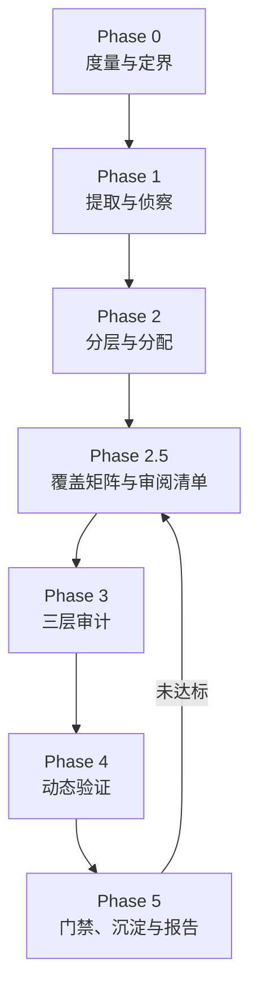

# IoT 固件漏洞挖掘

<p>  
    
    
    
    
    
    
</p>

> 把「资深固件审计员的工作骨架」装进大模型：**定义流程、分配资源、设置护栏、标准化输出**，并把中间状态持久化到文件系统，不信任模型的记忆。

面向 IoT / 嵌入式固件的系统化漏洞挖掘流水线。覆盖固件镜像、路由器 / 摄像头 / IPC / 智能门锁 / 智能家居设备、rootfs、嵌入式 ELF 二进制，从提取、静态审计、SBOM/CVE 排查，一路做到模拟运行、模糊测试、漏洞验证与报告输出。

---

## 目录

- [为什么需要它](#为什么需要它)
- [三层架构](#三层架构方法论--决策判据--原子能力)
- [流水线](#流水线)
- [七条铁律](#七条铁律)
- [安装](#安装)
- [快速开始](#快速开始)
- [脚本](#脚本)
- [参考文件](#参考文件)
- [目录结构](#目录结构)
- [设计来源](#设计来源)
- [许可](#许可)

---

## 为什么需要它

固件挖洞的难点**不是「看不懂代码」**，而是**没有系统化的工作流**。裸跑大模型会稳定复现九个失效模式：

| 失效模式    | 裸跑表现                                                   | 本 Skill 的约束                                         |
| ------- | ------------------------------------------------------ | --------------------------------------------------- |
| 随机游走    | 打开几个 `httpd` / `cgi-bin` 就深挖，忘了看过什么                    | 强制 Phase 流水线 + 每阶段落盘                                |
| 覆盖不全    | 只看 `www/` 和 `bin/`，漏掉 `etc/init.d`、`.so`、内核模块、shell 脚本 | Phase 2 强制分层枚举 + Phase 2.5 审阅清单三方对齐 + Phase 5 覆盖率门禁 |
| 假装覆盖    | **声称审完了、实际只审了 70–85%**                                 | 审阅清单逐项打勾 + 门禁 diff「计划 ↔ 声明 ↔ 结论」                    |
| 幻觉      | 编造函数名、伪造 `system()` 调用、凭印象写 CVE 号                      | 每条结论必须带 `文件:偏移` + 原始证据片段                            |
| 危险调用当漏洞 | 扫到 `system()` / `strcpy()` 就报 RCE / 溢出                 | 漏洞成立条件四问（代码存在 / 可达 / 可控 / 防护）+ 判定树                  |
| CVE 当漏洞 | 组件版本命中就写「设备存在 XX 漏洞」                                   | 铁律 7 + 门禁 CVE 纪律检查（V0–V3）                           |
| 深度不均    | 在静态图片上耗半天，放过 `upnpd` 的整数溢出                             | Tier 分层 + EALB 资源分配                                 |
| 优先级不实   | CVSS 全给 9.8，需拆机的和 WAN 可达的排同一档                          | DKTSS 评分（减法模型，Friction 显式扣除利用阻力）                    |
| 报告不可复现  | 每次格式不同、没有验证状态、缺字段                                      | 固定 7 区块模板 + CONFIRMED/HYPOTHESIS 两态 + 9 字段必填校验      |

其中**前六个已被脚本机械化拦截**——不是写进提示词里「请模型不要忘」，而是由 `coverage_gate.py` 在 Phase 5 直接检查并 `exit 1` 拦下。后三个靠规则资产与评分模型约束。

**Skill 不教模型「什么是命令注入」**，那是它已知的；它给模型装上流程骨架与机械门禁。

---

## 三层架构：方法论 / 决策判据 / 原子能力

这套 Skill 固化的**不是「完整工具」，而是三层能力**。这个分层是刻意的，也是它和 FAT / Firmadyne / EMBA 这类自动化平台的根本区别：

| 层 | 固化什么 | 承载位置 |
|---|---|---|
| **方法论层** | 决策逻辑、优先级、证据标准、降级策略、交付规范 | `SKILL.md`（七条铁律、Phase 0–5、EALB、三轨审计、G1–G6 门禁）· `references/methodology.md` · `references/reporting.md` |
| **决策判据层** | **识别到什么特征 → 走哪条路**，以及失败反馈信号 | `references/atomic-capabilities.md` §3（Phase 1 提取选路树 / Phase 4 仿真选路树） |
| **原子能力层** | **单个可调用的操作**：能力 / 实现方式 / 输入输出 | `references/atomic-capabilities.md` §1–§9（54 项：侦察、提取、内容扫描、文件系统侦察、二进制分析、动态验证、网络、硬件） |

**工作流是：侦察 → 按判据选路 → 调用原子能力 → 观察反馈 → 按反馈调整策略。**

不是「按顺序试工具」，更不是「调一个完整工具让它跑完」。举例：

- 提取阶段不问「先跑 unblob 还是 binwalk」，而是先侦察（`file` + 熵 + magic）→ **识别到 squashfs 就直取 `unsquashfs`/`moria -e`；识别到 UBIFS 就取 `ubireader`；熵 > 7.9 且无魔数就判定加密、先解决解密**，不进解包链。
- 仿真阶段不问「FAT 还是 Qiling」，而是先问「要证明什么」→ 整机可达性走 QEMU system，**启动失败先读 dmesg 定位原因、针对性修补**，而不是换下一个仿真器重跑。

> 整链自动化工具（FAT / Firmadyne / EMBA / FACT / firmwalker）**只有一个合法位置**：主路径跑完后的**交叉验证基线**，其输出按「线索」而非「结论」处理。遇到非常规固件时它们会在某一环卡死，剩下的只有依赖与兼容问题——因为它们在**替你决策**。

---

## 流水线



| Phase | 名称        | 输入                 | 输出                                               | 主要原子能力                       |
| ----- | --------- | ------------------ | ------------------------------------------------ | ---------------------------- |
| 0     | 度量与定界     | 固件镜像               | `00-metrics.json`、`00-scope.md`                  | `fw_triage.py`               |
| 1     | 提取与侦察     | 固件镜像               | `01-extract/`、`01-manifest.json`                 | 侦察 R1–R4 → 判据选路 → 解包 E1–E9  |
| 2     | 分层与分配     | `01-extract/`      | `02-tiering.json`、`03-audit-plan.md`             | `fw_triage.py --tier`        |
| 2.5   | 覆盖矩阵与审阅清单 | `03-audit-plan.md` | `25-review-list.md`                              | 声明 + 门禁 diff                 |
| 3     | 三层审计      | 分配清单               | `10-layer1-sinks.json`、`30-findings-verified.md` | `sink_scan.py` + 模型审计        |
| 4     | 动态验证      | 候选漏洞               | 每条候选的可利用性判定                                      | 仿真选路 → D1–D12 组合             |
| 5     | 门禁与报告     | 全部产物               | `40-coverage.md`、`report.md`、`50-rules/`         | `coverage_gate.py`           |

### Phase 速览

- **Phase 0 · 度量与定界** — 挖之前先知道「这是个什么东西、有多大、值不值得挖」。文件级扫描（大小 / Shannon 熵 / magic / 压缩加密判定）、分区块熵、ELF 加固画像（NX / PIE / Canary / RELRO / FORTIFY）、SUID 权限面、攻击面清单。
- **Phase 1 · 提取与侦察** — **先侦察再决策**：`file` + 熵扫描 + magic 判断格式，再按判据直取对应解包能力（squashfs / UBIFS / JFFS2 / ext / uImage 各有对应原子能力；未知则 `unblob` 递归 carve）。拿到 rootfs 后由 `mithril` 做 secrets / SBOM / CVE / boot / keys 六种模式侦察。固件常有的 SquashFS 变体、被抹零的 UPX 头、私有魔数都在这层处理；高熵无魔数则先判加密，不硬审乱码。
- **Phase 2 · 分层与分配** — 用 R0–R7 规则把提取产物分成 T1 / T2 / T3 / SKIP，再用 **EALB** 估算审计工作量并切分给多个 Agent。兜底规则永远最后评估，避免抢走静态资源。
- **Phase 2.5 · 覆盖矩阵** — 专治「声称 100% 实际漏审」。产出审阅清单，Phase 5 由门禁 diff 三方。
- **Phase 3 · 三层审计** — Layer 1 机器扫广度（不用 LLM）；Layer 2 三轨（Track A 自下而上追 Sink，Track B 自上而下枚举入口，**Track C 跨请求污点**：NVRAM/文件/IPC 的写-读配对）；Layer 3 语义链路验证（IDA / Ghidra / radare2）。
- **Phase 4 · 动态验证** — 只做「能把 HYPOTHESIS 升成 CONFIRMED」的事。**判据在节点上**：先问要证明什么（整机可达 / sink 参数真值 / 内存破坏 / CVE 可达），再按 QEMU 启动反馈逐步修补或组合单二进制模拟与模糊测试。
- **Phase 5 · 门禁、沉淀与报告** — 覆盖率门禁 + CVE 纪律检查 + 规则沉淀 + 固定 7 区块报告。

### EALB：给固件估「工作量」，而不是估字节

固件没有「代码行数」直觉，所以用 **ELF `.text` 段大小**（而非文件大小）乘 Tier 权重来估算认知负荷：

```python
text_units(f) =  ELF ?       section('.text').size / 1024
                脚本/文本 ?  line_count / 40          # 40 行 ≈ 1KB 代码的认知量
                其他 ?       0

weight  = {T1: 1.0, T2: 0.5, T3: 0.1, SKIP: 0}
EALB    = Σ weight[tier(f)] * text_units(f)
agents  = max(1, ceil(EALB / budget))                 # budget 默认 800
```

`budget` 按模型上下文取值：32K → 300、128K → 800、200K+ → 1500。

一个 42 MB 的 rootfs 里，真正需要逐行读的 `.text` 往往只有几 MB。实测样例：T1 3.2 MB（×1.0）+ T2 8.4 MB（×0.5）+ T3 22 MB（×0.1）= **9600**，即 12 个 Agent；而按裸字节切分是 `ceil(42000 / 800) = 43` 个——**省 72% 的算力，且不会漏审 T1**。

---

## 七条铁律

1. **证据优先** — 每条 finding 必须附 `路径:行号/文件偏移` + 原文片段（反汇编、反编译、字符串、配置行）。写不出证据的结论一律降级为「疑点」，不得写成漏洞。
2. **空结果也是结果** — 没找到就明确写 `NOT_FOUND` 并列出自查范围。禁止为凑数编造漏洞、CVE 编号或 PoC。
3. **状态落盘** — 所有中间结论写入 `fw-audit/<target>/`，不依赖上下文记忆。任何阶段被打断都能从文件恢复。
4. **置信度只写两态** — 对外只有 `CONFIRMED`（动态复现，或静态链路完整闭合且成立条件逐条验证通过）与 `HYPOTHESIS`（必须写明缺哪一步）。`HYPOTHESIS` 不计入漏洞总数。
5. **覆盖率门禁** — Phase 5 之前必须让分配清单里**每一个文件**都有审计结论。覆盖率 < 100% 不许出报告。
6. **凭据脱敏** — 私钥、口令、云 token 在报告里只保留指纹（如 `SHA256:ab12…` 前 8 位）与位置，完整值单独写入 `50-secrets.local`（不进报告）。
7. **CVE 命中 ≠ 可利用漏洞** — 版本落在影响区间只是一条**线索**。必须回到 Phase 3/4 验证可达性后才允许升级措辞：
   | 状态                | 判据             | 允许的措辞                        |
   | ----------------- | -------------- | ---------------------------- |
   | `cve-hit`         | 仅版本号落在影响区间     | 「疑似存在 CVE-XXXX-YYYY，尚未验证可达性」 |
   | `cve-reachable`   | 已定位到受影响函数的可达路径 | 「存在 CVE-XXXX-YYYY，可达路径为…」    |
   | `cve-exploitable` | 动态复现或完整利用链     | 「可被利用」                       |
   反例：某固件带 `busybox 1.31`（命中数十条 CVE），但该镜像编译时裁掉了相关 applet、或该版本已 backport 修复、或漏洞需要编译期未开启的选项——**版本在区间内但代码不存在，漏洞就不存在**。结论只能来自对固件内实际代码的检查，不能来自版本号。

---

## 安装

这是一个 **Agent Skill**，遵循开放的 Agent Skills 规范（`SKILL.md` + `references/` + `assets/` + `scripts/`），用 [`skills`](https://github.com/antfu/skills-cli) CLI 一行命令安装：

```bash
# 安装（自动探测本机已装的 Agent，装入其全局 skills 目录）
npx skills add https://github.com/DroidKali/iot-firmware-vuln-hunting -g

# 指定目标 Agent（-a 后填任意受支持的 Agent 标识）
npx skills add https://github.com/DroidKali/iot-firmware-vuln-hunting -a <agent> -g

# 先看看仓库里有哪些 Skill，不写入任何文件
npx skills add https://github.com/DroidKali/iot-firmware-vuln-hunting --list

# 非交互安装（CI / 批量 / 装到所有已探测 Agent）
npx skills add https://github.com/DroidKali/iot-firmware-vuln-hunting --agent '*' -g -y
```

常用管理命令：`npx skills list`（列出已装 Skill）、`npx skills update`（更新到最新）、`npx skills remove iot-firmware-vuln-hunting`（卸载）。

**作为通用知识库使用** — 不安装也行：`git clone` 到任意位置，按 `SKILL.md` 的流程手工执行；五个脚本可独立运行。

### 前置依赖

| 类别     | 说明                                                                                                                                                    |
| ------ | ----------------------------------------------------------------------------------------------------------------------------------------------------- |
| Python | 3.8+，**五个脚本只用标准库**，无第三方依赖，三平台均可运行。推荐用 [`uv`](https://github.com/astral-sh/uv) 管理（`uv run` 自动建临时环境）                                                    |
| 固件工具链  | 按判据**按需安装**，不必装齐：`unblob` / `binwalk` v3 / `moria` / `mithril` / `qemu-system-*` / `Qiling` / `AFL++` / `radare2`。Linux（Docker / WSL / Kali / AttifyOS）体验最好；Windows 宿主建议走 Docker |
| 授权     | **只在获得书面授权（自有设备 / 客户授权 / SRC 范围）的目标上执行**，开工前把范围写进 `fw-audit/<target>/00-scope.md`                                                                     |

> 某个原子能力缺席时，优先按 `references/atomic-capabilities.md` §11 找等价实现（如缺 `rg` → `grep -I`、缺 `ida-mcp` → Ghidra 无头 → radare2），并在报告中显式注明降级、说明是否影响结论强度。**不要为了「稳」去装 FAT / EMBA 这类整链工具**——它们只在主路径跑完后作交叉验证基线，装它的时间通常换不来结论。

---

## 快速开始

### 1. 验证安装

```bash
uv run scripts/selftest.py
```

脚本会用纯 Python 手工构造合法 ELF64 与合成 rootfs，端到端跑通另外四个脚本，覆盖 **14 组 / 101 条断言**，其中包含「门禁必须拦下坏报告」的负向用例。断言总数由脚本自己在结尾打印，不需要去数日志。看到全绿即安装成功。

最后一组 `[14/14]` 把**文档当被测对象**：抓出 `README.md` / `SKILL.md` / `references/` / `assets/` 里每条 `scripts/*.py` 示例命令，逐个核对命令里出现的 `--flag` 是否真存在于脚本 `--help`，并检查布尔开关后面没跟取值。这条守卫来自一次真实事故——文档把 `store_true` 的 `--tier` 写成 `--tier <rootfs>`，照抄必然报错，而所有单元测试都是绿的。

### 2. 一次完整审计

```bash
TARGET=myrouter
mkdir -p fw-audit/$TARGET

# Phase 0 — 度量与定界
uv run scripts/fw_triage.py firmware.bin --out fw-audit/$TARGET/00-metrics.json

# Phase 1 — 侦察后按判据选路（此处以识别到 squashfs 为例）
file firmware.bin && binwalk -E firmware.bin          # 先看清是什么
moria -e fw-audit/$TARGET/01-extract firmware.bin     # 命中 squashfs/UBI/JFFS2/ext 分支时的通用解包
#   其它分支：ubireader（UBIFS）、jefferson（JFFS2）、unsquashfs（squashfs 补刀）
#   无法识别时兜底：unblob --report 01-manifest.json -e fw-audit/$TARGET/01-extract firmware.bin

# Phase 2 — 分层与分配（Tier 规则 + EALB 预算）
# 注意：--rootfs 才是路径参数，--tier 是布尔开关；--plan 才会产出 03-audit-plan.md
uv run scripts/fw_triage.py \
    --rootfs fw-audit/$TARGET/01-extract \
    --tier --budget 800 \
    --out  fw-audit/$TARGET/02-tiering.json \
    --plan fw-audit/$TARGET/03-audit-plan.md

# Phase 3 Layer 1 — 机器扫广度（不使用 LLM）
uv run scripts/sink_scan.py fw-audit/$TARGET/01-extract \
    --rules assets/sink-rules.json \
    --json fw-audit/$TARGET/10-layer1-sinks.json

#   …… Phase 3 Layer 2/3、Phase 4 动态验证详见 SKILL.md ……

# Phase 5 — 正式审计门禁（strict 档位）
uv run scripts/coverage_gate.py \
    --profile     strict \
    --plan        fw-audit/$TARGET/03-audit-plan.md \
    --verified    fw-audit/$TARGET/30-findings-verified.md \
    --candidates  fw-audit/$TARGET/20-findings-candidates.jsonl \
    --review-list fw-audit/$TARGET/25-review-list.md \
    --tiering     fw-audit/$TARGET/02-tiering.json \
    --entrypoints fw-audit/$TARGET/entrypoints.json \
    --report      fw-audit/$TARGET/report.md \
    --out         fw-audit/$TARGET/40-coverage.md
```

**退出码 0 = 可出报告；非 0 = 有缺口**，缺口清单写入 `40-coverage.md` 的「待补审」节，回去补审再跑。

`--profile strict` 会强制启用全部高级检查（G4/G5/G6/Base），并要求 `--candidates`、`--review-list`、`--report`、`--entrypoints` 齐全；**任何必需检查未执行都判失败**，并在 `40-coverage.gate-config.json` 里记录本次到底跑了哪些检查、输入哈希与版本。

---

## 脚本

五个脚本都**只用 Python 标准库**，无第三方依赖。

| 脚本                         | 行数   | 用途                                                              |
| -------------------------- | ---- | --------------------------------------------------------------- |
| `scripts/fw_triage.py`     | 852  | Phase 0 / 2：固件度量、熵扫描、ELF 加固画像、SUID 面、Tier 分层、EALB 预算            |
| `scripts/coverage_gate.py` | 1657 | Phase 5：覆盖率门禁 + CVE 纪律检查（`--report`，V0–V4）+ 审阅清单三方对齐（`--review-list`）+ G4 入口级覆盖 + G5 绕过矩阵 + **G6 跨请求污点溯源** + 类型→Base + 自动修复计划 + **`--profile strict` 档位** + **`gate-config.json` 执行台账** |
| `scripts/sink_scan.py`     | 726  | Phase 3 Layer 1：多语言危险模式扫描（正则初筛 + ast-grep 结构级二次过滤；引擎缺失自动回退并记录；**分块流式读取 + `scan_integrity` 完整性台账**）                               |
| `scripts/entrypoints_init.py` | 139 | Phase 3 / 5：从 `02-tiering.json` 生成 `entrypoints.json` 骨架（`--merge` 保留已手填数据） |
| `scripts/selftest.py`      | 883  | 安装自检：合成固件与 rootfs，端到端验证上面四个脚本的判据 + **文档与 CLI 一致性**（14 组 / 101 条断言，结尾自报总数）                 |

### 覆盖率门禁判据

`coverage_gate.py` 逐项检查，任一不满足即失败：

- T1 文件覆盖率 **100%**（每个文件必须有审计结论或明确的 `NOT_FOUND`）
- T2 文件覆盖率 **≥ 95%**，未审文件必须列出理由
- 每条 `candidate` 必须有**结构化 `status`**，取值来自固定枚举：`hypothesis` / `confirmed` / `not_reproduced` / `not_applicable` / `pending_static_analysis` / `pending_dynamic_validation` / `blocked_by_environment`（另兼容旧写法 `validated` / `not_found`）。**「结论里提到过这个 ID」不算处置**；重复 ID、未知状态、`confirmed` 却无 `evidence` 均判失败；空清单需显式 `--allow-empty-candidates`
- 所有 `promotions`（Tier 动态提升）都要有对应的升级后分析
- 审阅清单一致：无 G1（声明未勾）/ G2（计划未声明）/ G3（勾选无结论）
- **G4 入口级覆盖**（`--entrypoints`）：服务型大二进制的 handler 需枚举完整，且每个入口有处置结论
- **G5 绕过矩阵**（`--bypass-check`）：写了「有防护 / 不可利用」的入口必须附 B1–B12 逐项证伪
- **G6 跨请求污点溯源**（`--cross-request`）：Source 指向持久化存储（nvram/uci 键、/tmp·/var 可写路径）的漏洞必须声明**写入面**（污点跨请求传递，Bridge/IEEE S&P'26）
- **类型 → DKTSS Base 命中**（`--type-base`）：报告里出现的类型必须能映射到 Base 表（`--type-base-strict` 下未命中即失败）
- 报告完整性：9 个必填字段齐全

`--report` 另外触发 CVE 纪律检查 **V0–V4**：缺「组件风险（未验证）」区块（V0）/ 版本命中写成漏洞断言（V1）/ CVE 混进「漏洞统计」表（V2）/ 未验证的组件 CVE 被打了 P0–P3 或 CVSS（V3）/ **同一 CVE-ID 同时出现在 ④ 与 ⑥（V4：应「移动」而非「复制」）**。

### 门禁档位与 SKIPPED 语义

| 档位 | 必需输入 | SKIPPED 的处理 |
| --- | --- | --- |
| `light` | `--plan --verified` | 仅提示 |
| `standard`（默认） | 同上 | 仅提示，**但报告里逐项列出** |
| `strict` | 另需 `--candidates --review-list --report --entrypoints` | **必需检查的 SKIPPED 判为失败** |

每项检查输出 `PASS` / `FAIL` / `SKIPPED` 三态，且 `SKIPPED` 明确表示「本次没有执行」而不是「通过」。

> **为什么不只看退出码。** `exit 0` 曾经只意味着「已执行的检查都过了」——高级检查没启用时它们根本不出现在报告里，于是「脚本支持 G5」被误读成「本次跑了 G5 且通过了」。现在未执行的检查一律以 `SKIPPED` 出现在判据表里，`strict` 还会把它们判失败。`gate-config.json` 同步记录档位、输入 SHA-256、每项检查状态与门禁版本，换台机器也能复算同一次判定。

### 静态扫描规则库

`assets/sink-rules.json` — **38 条规则 / 15 类**，含阈值与白名单：

| 优先级 | 条数 | 分布（类别：条数）                                                                                       |
| --- | -- | ---------------------------------------------------------------------------------------------- |
| P0  | 11 | cmd-exec 5、memory 3、web 1、privileged 1、deserialization 1                                        |
| P1  | 14 | crypto 4、auth 4、**cross-request 2**、ota 1、permission 1、config 1、attack-surface 1                 |
| P2  | 9  | crypto 2、**cross-request 2**、credential 2、debug 2、memory 1                                     |
| P3  | 4  | info 3、attack-surface 1                                                                       |

`cross-request` 类（4 条）为**跨请求污点形态标记**：NVRAM 读端 / 写端、IPC 收包端、运行时可写路径文件——命中后须做「写-读配对」并回溯写入面（见 Phase 3 Track C 与 `references/methodology.md` §3.2）。

> **二进制规则与源码规则严格分离。** 剥离符号的 ELF `.dynstr` 里只有裸符号名（`system` 而非 `system(`），套用源码正则 `system\s*\(` 会**系统性漏检所有 PLT 调用**。因此单开一套 `P0-B-*` 规则用词边界匹配，并在输出里把命中类型标为 `binary-string`——它只说明「二进制里有这个字符串」，不等于「代码调用了它并传了用户输入」。

> **脚本 / web 目标的二次过滤（v1.2 起）。** 正则分不清「代码」与「注释 / 字符串」（`# eval "$x"`、`echo "system(id)"`、`// system($x)` 都会误报）。P0/P1 的 script/web 规则额外带 `structural` 字段：对**正则已命中**的文件用 `ast-grep` 按语法树确认，结构否定即判为误报丢弃。引擎缺失或语言不可判时**自动回退正则，并记录进 `engine_status.fallbacks`**（不静默）。三条要点：只作二次过滤、对剥离符号的 ELF **不适用**、**不要把反编译伪代码喂给它**（IDA 伪代码不是合法 C）。判据见 `references/atomic-capabilities.md` §3.3，实现见 §5.2。

### 扫描完整性（`scan_integrity`）

`sink_scan.py` 不再「读个文件头就当扫完」。二进制按 `--read-chunk-mb`（默认 4 MiB）**分块流式读取**，跨块边界的字符串用 carry 缓冲拼接、不会漏检；每次输出都带完整性台账：

```json
"scan_integrity": {
  "complete": false,
  "files_scanned": 41, "files_skipped": 2, "files_partial": 1,
  "skip_reason_counts": {"too-large": 2},
  "skipped_files": [{"file": "usr/sbin/httpd", "reason": "too-large",
                     "bytes_total": 20971520, "limit_bytes": 100663296}],
  "partial_files": [{"file": "www/big.js", "truncation_reason": "line-limit",
                     "lines_total": 400001, "lines_scanned": 400000}]
}
```

四类跳过原因分开记：`skip-dir`（设计如此）/ `excluded`（调用方排除）/ `too-large`（能力边界）/ `stat-failed`（异常）。**`complete: false` 时不得在报告里声称「已完整扫描」**——直接把 `scan_integrity` 贴进报告附录即可。

> 旧实现只 `f.read(8 << 20)`，20 MB 的 CGI 二进制后半段一个字符串都扫不到，输出里还看不出来。回归测试 `[13/14]` 用 9.5 MiB 偏移与跨块边界两个样本把这条钉死。

---

## 参考文件

按需加载，不要一次全读。

| 文件                                | 行数  | 何时读                                                  |
| --------------------------------- | --- | ---------------------------------------------------- |
| `references/atomic-capabilities.md` | 716 | **决策判据 + 原子能力**：Phase 1 提取选路（§3.1）、Phase 4 仿真选路（§3.2）、**Phase 3 Layer 1 引擎选路（§3.3）**、54 项原子能力清单与实现命令（§1–§9）、**结构级脚本扫描（§5.2）**、整链工具的合法定位（§10.2）、能力缺席时的替代路径（§11） |
| `references/methodology.md`       | 491 | 需要 Tier 规则细节、EALB 计算、**三轨模型（Track A/B/C）**、跨请求污点（§3.2）、门禁判据的完整定义                  |
| `references/emulation-fuzzing.md` | 357 | Phase 4 需要模拟与模糊的具体做法、踩坑与替代方案                         |
| `references/reporting.md`         | 353 | Phase 5 需要报告字段、评分表、脱敏规范、DKTSS、⑥↔④ 迁移规则、G6 写入面                              |
| `references/vuln-conditions.md`   | 393 | **Layer 3 / Phase 4**：候选要不要升 `CONFIRMED`？按类型逐条排除成立条件 |
| `references/sink-patterns.md`     | 257 | 需要扩充或理解静态扫描规则（含 `structural` 结构级规则 schema），或手写 grep / YARA                        |
| `references/vuln-taxonomy.md`     | 218 | 需要按攻击面 / 漏洞类型逐项核查（后门账号、命令注入、OTA、MQTT、U-Boot…）        |
| `references/resource-index.md`    | 233 | 需要外部资料：awesome-connected-things-sec 精编索引（按阶段映射）      |

---

## 目录结构


```
iot-firmware-vuln-hunting/
├── SKILL.md                      # 主入口：流水线 + 七条铁律 + 各 Phase 操作细节
├── README.md
├── LICENSE
├── references/                   # 8 篇按需加载的知识库
│   ├── methodology.md            # 方法论层：Tier 规则 / EALB / 三层审计（Track A/B/C）/ 门禁判据完整定义
│   ├── atomic-capabilities.md    # 判据层 + 原子能力层：Phase 1/4 选路树 + 54 项原子能力 + 替代路径矩阵
│   ├── vuln-conditions.md        # 漏洞成立条件判定表（固件版）
│   ├── vuln-taxonomy.md          # 漏洞分类学（按攻击面，13 类）
│   ├── sink-patterns.md          # 静态扫描模式库 schema 与规则说明
│   ├── emulation-fuzzing.md      # 模拟与模糊测试实操
│   ├── reporting.md              # 报告规范 + IoT 评分 + DKTSS
│   └── resource-index.md         # 外部资源索引
├── assets/
│   ├── sink-rules.json           # 38 条规则 / 15 类（数据驱动扫描，含 cross-request 跨请求污点与 structural 结构级二次过滤）
│   ├── tier-rules.json           # R0–R7 分层规则
│   └── report-template.md        # 固定 7 区块报告模板
└── scripts/                      # 5 个纯标准库 Python 脚本
    ├── fw_triage.py
    ├── sink_scan.py
    ├── coverage_gate.py
    ├── entrypoints_init.py
    └── selftest.py
```

审计产物统一落在工作目录的 `fw-audit/<target>/`：

```
fw-audit/<target>/
├── 00-scope.md                   授权与边界
├── 00-metrics.json               Phase 0 度量结果
├── 01-extract/                   提取产物（rootfs 等）
├── 01-manifest.json              提取报告（chunk 偏移/类型/置信度）
├── 02-tiering.json               Tier 分层 + EALB 预算
├── 03-audit-plan.md              分配清单（谁审哪些文件）
├── 25-review-list.md             Phase 2.5 审阅清单（声明 + 逐项打勾）
├── 10-layer1-sinks.json          Layer 1 机器扫描结果
├── 20-findings-candidates.jsonl  Layer 2 三轨候选（含跨请求污点）
├── 30-findings-verified.md       Layer 3 验证后结论（含 NOT_FOUND 台账）
├── 40-coverage.md                覆盖率门禁报告
├── 50-rules/                     Phase 5 沉淀的 YARA / grep 规则
├── 50-secrets.local              敏感信息完整值（脱敏，不进报告、不入库）
└── report.md                     最终报告
```

---

## 设计来源

本 Skill 把 [大可实验室《AI 挖 Java 0day 不再靠运气》](https://mp.weixin.qq.com/s/HeC-2Ydyx8SmjxPj8EtKcw) 的软件供应链审计流水线迁移到固件场景：

| 文章中的机制                                   | 固件场景对应                                                                         |
| ---------------------------------------- | ------------------------------------------------------------------------------ |
| 6 阶段流水线                                  | Phase 0–5 + Phase 2.5                                                          |
| EALOC 分层                                 | **EALB**（`ELF .text` 段大小 × Tier 权重）                                            |
| 三层审计架构                                   | Layer 1 机器扫 / Layer 2 三轨 / Layer 3 语义链路                                        |
| 双轨模型                                     | Track A（Sink 驱动）+ Track B（入口驱动）+ **Track C（跨请求污点，源自 Bridge / IEEE S&P'26）**       |
| 覆盖矩阵、CONFIRMED/HYPOTHESIS、漏洞成立条件表、报告必填字段 | Phase 2.5、`vuln-conditions.md`、`reporting.md` §3.1 与 `coverage_gate.py` 的机械化门禁 |

工具生态取自：

[moria](https://github.com/nmatt0/moria) · [mithril](https://github.com/nmatt0/mithril) · [unblob](https://github.com/onekey-sec/unblob) · [binwalk](https://github.com/ReFirmLabs/binwalk) · [firmware-analysis-toolkit](https://github.com/attify/firmware-analysis-toolkit) · [Qiling](https://github.com/qilingframework/qiling) · [AFL++](https://github.com/AFLplusplus/AFLplusplus) · [awesome-connected-things-sec](https://github.com/v33ru/awesome-connected-things-sec)

二进制逆向侧支持 [IDA Pro](https://hex-rays.com/ida-pro) + [ida-mcp](https://github.com/HexRaysSA/ida-mcp)（真语义）→ Ghidra 无头（批量语义）→ radare2 手工追链（可行但慢）→ `objdump` + `strings`（兜底）的四级取舍链，**证据等级不打折**。

---

## 免责声明

本工具仅用于**获得授权的**安全评估、自有设备排查与 SRC 范围测试。使用者需自行确保对目标拥有合法授权，并遵守所在地区法律法规。作者不对任何未授权使用承担责任。

---

## 许可

[Apache License 2.0](LICENSE)
