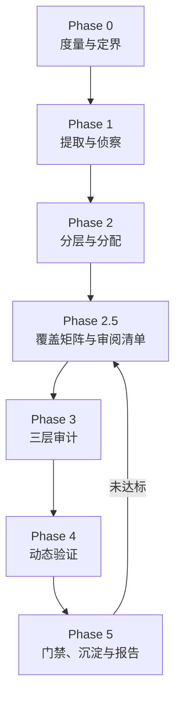

# IoT 固件漏洞挖掘

<p>  
    
    
    
  
  
    
</p>

> 把「资深固件审计员的工作骨架」装进大模型：**定义流程、分配资源、设置护栏、标准化输出**，并把中间状态持久化到文件系统，不信任模型的记忆。

面向 IoT / 嵌入式固件的系统化漏洞挖掘流水线。覆盖固件镜像、路由器 / 摄像头 / IPC / 智能门锁 / 智能家居设备、rootfs、嵌入式 ELF 二进制，从提取、静态审计、SBOM/CVE 排查，一路做到模拟运行、模糊测试、漏洞验证与报告输出。

---

## 目录

- [为什么需要它](#为什么需要它)
- [三层架构](#三层架构方法论--决策判据--原子能力)
- [流水线](#流水线)
- [七条铁律](#七条铁律)
- [安装](#安装)
- [快速开始](#快速开始)
- [黑板（M1）](#黑板m1)
- [资源准入（M2）](#资源准入m2)
- [EMBA 适配器（M3）](#emba-适配器m3)
- [轻量整机仿真（M4）](#轻量整机仿真m4)
- [路线图](#路线图)
- [脚本](#脚本)
- [参考文件](#参考文件)
- [目录结构](#目录结构)
- [设计来源](#设计来源)
- [许可](#许可)

---

## 为什么需要它

固件挖洞的难点**不是「看不懂代码」**，而是**没有系统化的工作流**。裸跑大模型会稳定复现九个失效模式：

| 失效模式    | 裸跑表现                                                   | 本 Skill 的约束                                         |
| ------- | ------------------------------------------------------ | --------------------------------------------------- |
| 随机游走    | 打开几个 `httpd` / `cgi-bin` 就深挖，忘了看过什么                    | 强制 Phase 流水线 + 每阶段落盘                                |
| 覆盖不全    | 只看 `www/` 和 `bin/`，漏掉 `etc/init.d`、`.so`、内核模块、shell 脚本 | Phase 2 强制分层枚举 + Phase 2.5 审阅清单三方对齐 + Phase 5 覆盖率门禁 |
| 假装覆盖    | **声称审完了、实际只审了 70–85%**                                 | 审阅清单逐项打勾 + 门禁 diff「计划 ↔ 声明 ↔ 结论」                    |
| 幻觉      | 编造函数名、伪造 `system()` 调用、凭印象写 CVE 号                      | 每条结论必须带 `文件:偏移` + 原始证据片段                            |
| 危险调用当漏洞 | 扫到 `system()` / `strcpy()` 就报 RCE / 溢出                 | 漏洞成立条件四问（代码存在 / 可达 / 可控 / 防护）+ 判定树                  |
| CVE 当漏洞 | 组件版本命中就写「设备存在 XX 漏洞」                                   | 铁律 7 + 门禁 CVE 纪律检查（V0–V3）                           |
| 深度不均    | 在静态图片上耗半天，放过 `upnpd` 的整数溢出                             | Tier 分层 + EALB 资源分配                                 |
| 优先级不实   | CVSS 全给 9.8，需拆机的和 WAN 可达的排同一档                          | DKTSS 评分（减法模型，Friction 显式扣除利用阻力）                    |
| 报告不可复现  | 每次格式不同、没有验证状态、缺字段                                      | 工作简报 + 固定 7 个技术区块模板 + CONFIRMED/HYPOTHESIS 两态 + 9 字段必填校验 |

其中**前六个已被脚本机械化拦截**——不是写进提示词里「请模型不要忘」，而是由 `coverage_gate.py` 在 Phase 5 直接检查并 `exit 1` 拦下。后三个靠规则资产与评分模型约束。

**Skill 不教模型「什么是命令注入」**，那是它已知的；它给模型装上流程骨架与机械门禁。

---

## 三层架构：方法论 / 决策判据 / 原子能力

这套 Skill 固化的**不是「完整工具」，而是三层能力**。这个分层是刻意的，也是它和 FAT / Firmadyne / EMBA 这类自动化平台的根本区别：

| 层 | 固化什么 | 承载位置 |
|---|---|---|
| **方法论层** | 决策逻辑、优先级、证据标准、降级策略、交付规范 | `SKILL.md`（七条铁律、Phase 0–5、EALB、三轨审计、G1–G7 门禁）· `references/methodology.md` · `references/reporting.md` |
| **决策判据层** | **识别到什么特征 → 走哪条路**，以及失败反馈信号 | `references/atomic-capabilities.md` §3（Phase 1 提取选路树 / Phase 4 仿真选路树） |
| **原子能力层** | **单个可调用的操作**：能力 / 实现方式 / 输入输出 | `references/atomic-capabilities.md` §1–§9（54 项：侦察、提取、内容扫描、文件系统侦察、二进制分析、动态验证、网络、硬件） |

**工作流是：侦察 → 按判据选路 → 调用原子能力 → 观察反馈 → 按反馈调整策略。**

不是「按顺序试工具」，更不是「调一个完整工具让它跑完」。举例：

- 提取阶段不问「先跑 unblob 还是 binwalk」，而是先侦察（`file` + 熵 + magic）→ **识别到 squashfs 就直取 `unsquashfs`/`moria -e`；识别到 UBIFS 就取 `ubireader`；熵 > 7.9 且无魔数就判定加密、先解决解密**，不进解包链。
- 仿真阶段不问「FAT 还是 Qiling」，而是先问「要证明什么」→ 整机可达性走 QEMU system，**启动失败先读 dmesg 定位原因、针对性修补**，而不是换下一个仿真器重跑。

> 整链自动化工具（FAT / Firmadyne / EMBA / FACT / firmwalker）**只有一个合法位置**：主路径跑完后的**交叉验证基线**，其输出按「线索」而非「结论」处理。遇到非常规固件时它们会在某一环卡死，剩下的只有依赖与兼容问题——因为它们在**替你决策**。

---

## 流水线



| Phase | 名称        | 输入                 | 输出                                               | 主要原子能力                       |
| ----- | --------- | ------------------ | ------------------------------------------------ | ---------------------------- |
| 0     | 度量与定界     | 固件镜像               | `00-metrics.json`、`00-scope.md`                  | `fw_triage.py`               |
| 1     | 提取与侦察     | 固件镜像               | `01-extract/`、`01-manifest.json`                 | 侦察 R1–R4 → 判据选路 → 解包 E1–E9  |
| 2     | 分层与分配     | `01-extract/`      | `02-tiering.json`、`03-audit-plan.md`             | `fw_triage.py --tier`        |
| 2.5   | 覆盖矩阵与审阅清单 | `03-audit-plan.md` | `25-review-list.md`                              | 声明 + 门禁 diff                 |
| 3     | 三层审计      | 分配清单               | `10-layer1-sinks.json`、`30-findings-verified.md` | `sink_scan.py` + 模型审计        |
| 4     | 动态验证      | 候选漏洞               | 每条候选的可利用性判定                                      | 仿真选路 → D1–D12 组合             |
| 5     | 门禁与报告     | 全部产物               | `40-coverage.md`、`report.md`、`50-rules/`         | `coverage_gate.py`           |

### Phase 速览

- **Phase 0 · 度量与定界** — 挖之前先知道「这是个什么东西、有多大、值不值得挖」。文件级扫描（大小 / Shannon 熵 / magic / 压缩加密判定）、分区块熵、ELF 加固画像（NX / PIE / Canary / RELRO / FORTIFY）、SUID 权限面、攻击面清单。
- **Phase 1 · 提取与侦察** — **先侦察再决策**：`file` + 熵扫描 + magic 判断格式，再按判据直取对应解包能力（squashfs / UBIFS / JFFS2 / ext / uImage 各有对应原子能力；未知则 `unblob` 递归 carve）。拿到 rootfs 后由 `mithril` 做 secrets / SBOM / CVE / boot / keys 六种模式侦察。固件常有的 SquashFS 变体、被抹零的 UPX 头、私有魔数都在这层处理；高熵无魔数则先判加密，不硬审乱码。
- **Phase 2 · 分层与分配** — 用 R0–R7 规则把提取产物分成 T1 / T2 / T3 / SKIP，再用 **EALB** 估算审计工作量并切分给多个 Agent。兜底规则永远最后评估，避免抢走静态资源。
- **Phase 2.5 · 覆盖矩阵** — 专治「声称 100% 实际漏审」。产出审阅清单，Phase 5 由门禁 diff 三方。
- **Phase 3 · 三层审计** — Layer 1 机器扫广度（不用 LLM）；Layer 2 三轨（Track A 自下而上追 Sink，Track B 自上而下枚举入口，**Track C 跨请求污点**：NVRAM/文件/IPC 的写-读配对 + 动作依赖图，已在 DIR878 上跑通 Bridge 全流程复现：1188 键 / 35 条高阶）；Layer 3 语义链路验证（IDA / Ghidra / radare2）。
- **Phase 4 · 动态验证** — 只做「能把 HYPOTHESIS 升成 CONFIRMED」的事。**判据在节点上**：先问要证明什么（整机可达 / sink 参数真值 / 内存破坏 / CVE 可达），再按 QEMU 启动反馈逐步修补或组合单二进制模拟与模糊测试。
- **Phase 5 · 门禁、沉淀与报告** — 覆盖率门禁 + CVE 纪律检查 + 规则沉淀 + 工作简报 + 固定 7 个技术区块报告。

### EALB：给固件估「工作量」，而不是估字节

固件没有「代码行数」直觉，所以用 **ELF `.text` 段大小**（而非文件大小）乘 Tier 权重来估算认知负荷：

```python
text_units(f) =  ELF ?       section('.text').size / 1024
                脚本/文本 ?  line_count / 40          # 40 行 ≈ 1KB 代码的认知量
                其他 ?       0

weight  = {T1: 1.0, T2: 0.5, T3: 0.1, SKIP: 0}
EALB    = Σ weight[tier(f)] * text_units(f)
agents  = max(1, ceil(EALB / budget))                 # budget 默认 800

> **校准状态**：当前 `assets/ealb-calibration.json` 的 `status` 是 `heuristic`——EALB 只表示**相对工作量**，用于排序和切分 Agent，不能当工期承诺。真实工时样本 ≥20 才进 `experimental`，≥60 且 MAPE ≤0.30 才进 `calibrated`；门槛与命令见 `scripts/ealb_calib.py`（`predict` / `evaluate` / `fit` / `check`）。
```

`budget` 按模型上下文取值：32K → 300、128K → 800、200K+ → 1500。

一个 42 MB 的 rootfs 里，真正需要逐行读的 `.text` 往往只有几 MB。实测样例：T1 3.2 MB（×1.0）+ T2 8.4 MB（×0.5）+ T3 22 MB（×0.1）= **9600**，即 12 个 Agent；而按裸字节切分是 `ceil(42000 / 800) = 43` 个——**省 72% 的算力，且不会漏审 T1**。

---

## 七条铁律

1. **证据优先** — 每条 finding 必须附 `路径:行号/文件偏移` + 原文片段（反汇编、反编译、字符串、配置行）。写不出证据的结论一律降级为「疑点」，不得写成漏洞。
2. **空结果也是结果** — 没找到就明确写 `NOT_FOUND` 并列出自查范围。禁止为凑数编造漏洞、CVE 编号或 PoC。
3. **状态落盘** — 所有中间结论写入 `fw-audit/<target>/`，不依赖上下文记忆。任何阶段被打断都能从文件恢复。
4. **置信度只写两态** — 对外只有 `CONFIRMED`（动态复现，或静态链路完整闭合且成立条件逐条验证通过）与 `HYPOTHESIS`（必须写明缺哪一步）。`HYPOTHESIS` 不计入漏洞总数。
5. **覆盖率门禁** — Phase 5 之前必须让分配清单里**每一个文件**都有审计结论。覆盖率 < 100% 不许出报告。
6. **凭据脱敏** — 私钥、口令、云 token 在报告里只保留指纹（如 `SHA256:ab12…` 前 8 位）与位置，完整值单独写入 `50-secrets.local`（不进报告）。
7. **CVE 命中 ≠ 可利用漏洞** — 版本落在影响区间只是一条**线索**。必须回到 Phase 3/4 验证可达性后才允许升级措辞：
   | 状态                | 判据             | 允许的措辞                        |
   | ----------------- | -------------- | ---------------------------- |
   | `cve-hit`         | 仅版本号落在影响区间     | 「疑似存在 CVE-XXXX-YYYY，尚未验证可达性」 |
   | `cve-reachable`   | 已定位到受影响函数的可达路径 | 「存在 CVE-XXXX-YYYY，可达路径为…」    |
   | `cve-exploitable` | 动态复现或完整利用链     | 「可被利用」                       |
   反例：某固件带 `busybox 1.31`（命中数十条 CVE），但该镜像编译时裁掉了相关 applet、或该版本已 backport 修复、或漏洞需要编译期未开启的选项——**版本在区间内但代码不存在，漏洞就不存在**。结论只能来自对固件内实际代码的检查，不能来自版本号。

---

## 安装

这是一个 **Agent Skill**，遵循开放的 Agent Skills 规范（`SKILL.md` + `references/` + `assets/` + `scripts/`），用 [`skills`](https://github.com/vercel-labs/skills) CLI 一行命令安装：

```bash
# 安装（自动探测本机已装的 Agent，装入其全局 skills 目录）
npx skills add https://github.com/DroidKali/iot-firmware-vuln-hunting -g

# 指定目标 Agent（-a 后填任意受支持的 Agent 标识）
npx skills add https://github.com/DroidKali/iot-firmware-vuln-hunting -a <agent> -g

# 先看看仓库里有哪些 Skill，不写入任何文件
npx skills add https://github.com/DroidKali/iot-firmware-vuln-hunting --list

# 非交互安装（CI / 批量 / 装到所有已探测 Agent）
npx skills add https://github.com/DroidKali/iot-firmware-vuln-hunting --agent '*' -g -y
```

常用管理命令：`npx skills list`（列出已装 Skill）、`npx skills update`（更新到最新）、`npx skills remove iot-firmware-vuln-hunting`（卸载）。

**作为通用知识库使用** — 不安装也行：`git clone` 到任意位置，按 `SKILL.md` 的流程手工执行；十八个脚本可独立运行。

### 前置依赖

| 类别     | 说明                                                                                                                                                    |
| ------ | ----------------------------------------------------------------------------------------------------------------------------------------------------- |
| Python | 3.8+，**十八个脚本只用标准库**，无第三方依赖，三平台均可运行。推荐用 [`uv`](https://github.com/astral-sh/uv) 管理（`uv run` 自动建临时环境）                                                    |
| 固件工具链  | 按判据**按需安装**，不必装齐：`unblob` / `binwalk` v3 / `moria` / `mithril` / `qemu-system-*` / `Qiling` / `AFL++` / `radare2`。Linux（Docker / WSL / Kali / AttifyOS）体验最好；Windows 宿主建议走 Docker |
| 授权     | **只在获得书面授权（自有设备 / 客户授权 / SRC 范围）的目标上执行**，开工前把范围写进 `fw-audit/<target>/00-scope.md`                                                                     |

> 某个原子能力缺席时，优先按 `references/atomic-capabilities.md` §11 找等价实现（如缺 `rg` → `grep -I`、缺 `ida-mcp` → Ghidra 无头 → radare2），并在报告中显式注明降级、说明是否影响结论强度。**不要为了「稳」去装 FAT / EMBA 这类整链工具**——它们只在主路径跑完后作交叉验证基线，装它的时间通常换不来结论。

---

## 快速开始

### 1. 验证安装

```bash
uv run scripts/selftest.py
```

脚本会用纯 Python 手工构造合法 ELF64 与合成 rootfs，端到端跑通其余十七个脚本，覆盖 **24 组 / 273 条断言**，其中包含「门禁必须拦下坏报告」的负向用例。断言总数由脚本自己在结尾打印，不需要去数日志。看到全绿即安装成功。

`[14/24]` 把**文档当被测对象**：抓出 `README.md` / `SKILL.md` / `references/` / `assets/` 里每条 `scripts/*.py` 示例命令，逐个核对命令里出现的 `--flag` 是否真存在于脚本 `--help`（有子命令的会逐个进去问），并检查布尔开关后面没跟取值。这条守卫来自一次真实事故——文档把 `store_true` 的 `--tier` 写成 `--tier <rootfs>`，照抄必然报错，而所有单元测试都是绿的。

`[15/24]` 用 DIR878 的动机样例（`SetNetwork` 写 `lan0_management_link`、`SetRouterLanSettings` 读进 `system`）跑通 BDG/ADG，并验证三条否决路径：同一 action 内读写必须判**一阶**、缺 evidence 必须失败、拼不出来的键必须记 `unknown` 而不是占位。

`[16/24]`–`[20/24]` 覆盖本轮整改新增的契约与边界：候选清单里**非法 JSON 行必须逐行上报**、strict 只接受带 schema 的 envelope；扫描完整性/阶段状态降级必须可见且可阻断；`contracts.py` 校验 FirmwareManifest / AuditTask 并核对镜像哈希；`sandbox_run.py` 在无隔离运行时 **fail-closed**（退出 3），绝不静默回退宿主机；`bench_eval.py` 用合成基准复算 precision/recall，并验证相对基线的召回暴跌会以退出码 3 阻断。

`[21/24]` 覆盖 M1 黑板：Fact / Intent / EmulationResult / BoardState / BoardEvent 契约，事件日志去重与 `seq` 连续性，快照删除后从日志恢复，非法状态转换（`hypothesis → validated`）被拒绝，`validated → confirmed` 的类型化证据校验，以及 `BACKTRACK` 的当前阶段一致性。

`[22/24]` 覆盖 M2 资源准入：策略字段与未知字段拒绝、超时/内存/CPU/PID/镜像越界必须在启动前拒绝（退出 4）、并发槽位排队与排队超时（退出 5，`command=[]`）、预算耗尽不启动、fake runtime 下的成功/超时/`rm -f` 清理/临时输出目录删除、输出目录对容器 uid 65534 的可写位，以及 `exec_paths.py` 对执行路径清单与未分类调用的阻断。

`[23/24]` 覆盖 M3 EMBA 离线适配：解析 F50/P99/S09/L15/L10/S115 六类产物，重复解析输出字节一致；缺 F50、版本不符、固件哈希不符返回结构化失败；缺可选日志为 `partial`（`--strict` 下退出 3），`--require` 指定的产物缺失则直接 `failed`；P99 的 PE32 落成 `file` 而不是 `elf`；L10 无开放端口时不生成 `port-response`；F50 的用户态仿真字段按计数解释；三类观察落成不同 `Fact.type`（`service` / `runtime-process` / `port-response`），证据类型分别为 `static` / `emulation` / `dynamic`；`board_store.py import --emba` 可幂等导入且拒绝跨 run 或 `failed` 结果。

`[24/24]` 覆盖 M4 整机仿真执行链：从合成 rootfs、内核与假 ext2 镜像生成 `ready` 计划并校验 `emulation-plan/1.0` 契约；`--check` 缺 run/intent/固件哈希时以退出 3 阻断、镜像哈希被替换时返回 `IMAGE_HASH_MISMATCH`；计划阻断时写 `BLOCKED` 结果且完全不启动沙箱；假 sandbox 下的 console-ready、VFS 挂载失败、仅内核日志、空串口分别归为 `SUCCESS` / `FAILED rootfs-mount` / `PARTIAL` / `FAILED boot-no-output`，并断言结果只能产生 `emulation` 观察、不会生成 finding；新增 `kernel-format` 回归，防止把厂商 raw 内核被 QEMU 拒绝误判成 rootfs 不可用。**该组用假 sandbox，只验证契约与分类，不证明真实 QEMU 启动成功**；真实启动见 `assets/qemu/real-run-malta/`。

### 2. 一次完整审计

```bash
TARGET=myrouter
mkdir -p fw-audit/$TARGET

# Phase 0 — 度量与定界
uv run scripts/fw_triage.py firmware.bin --out fw-audit/$TARGET/00-metrics.json

# Phase 1 — 侦察后按判据选路（此处以识别到 squashfs 为例）
file firmware.bin && binwalk -E firmware.bin          # 先看清是什么
moria -e fw-audit/$TARGET/01-extract firmware.bin     # 命中 squashfs/UBI/JFFS2/ext 分支时的通用解包
#   其它分支：ubireader（UBIFS）、jefferson（JFFS2）、unsquashfs（squashfs 补刀）
#   无法识别时兜底：unblob --report 01-manifest.json -e fw-audit/$TARGET/01-extract firmware.bin

# Phase 2 — 分层与分配（Tier 规则 + EALB 预算）
# 注意：--rootfs 才是路径参数，--tier 是布尔开关；--plan 才会产出 03-audit-plan.md
uv run scripts/fw_triage.py \
    --rootfs fw-audit/$TARGET/01-extract \
    --tier --budget 800 \
    --out  fw-audit/$TARGET/02-tiering.json \
    --plan fw-audit/$TARGET/03-audit-plan.md

# Phase 3 Layer 1 — 机器扫广度（不使用 LLM）
uv run scripts/sink_scan.py fw-audit/$TARGET/01-extract \
    --rules assets/sink-rules.json \
    --json fw-audit/$TARGET/10-layer1-sinks.json

#   …… Phase 3 Layer 2/3、Phase 4 动态验证详见 SKILL.md ……

# Phase 5 — 正式审计门禁（strict 档位）
uv run scripts/coverage_gate.py \
    --profile     strict \
    --plan        fw-audit/$TARGET/03-audit-plan.md \
    --verified    fw-audit/$TARGET/30-findings-verified.md \
    --candidates  fw-audit/$TARGET/20-findings-candidates.jsonl \
    --review-list fw-audit/$TARGET/25-review-list.md \
    --tiering     fw-audit/$TARGET/02-tiering.json \
    --entrypoints fw-audit/$TARGET/entrypoints.json \
    --taint-graph fw-audit/$TARGET/taint-graph.json \
    --layer1      fw-audit/$TARGET/10-layer1-sinks.json \
    --stages      fw-audit/$TARGET/30-stages.json \
    --manifest    fw-audit/$TARGET/00-manifest.json \
    --audit-task  fw-audit/$TARGET/20-tasks.json \
    --require-structural \
    --report      fw-audit/$TARGET/report.md \
    --out         fw-audit/$TARGET/40-coverage.md
```

**退出码 0 = 可出报告；非 0 = 有缺口**，缺口清单写入 `40-coverage.md` 的「待补审」节，回去补审再跑。

报告开头必须先写一页「审计工作简报」：首句用固定状态词写范围与结果，然后写关键发现表、验证表、未做、待确认。关键发现最多 5 条，位置写到 `path:line` 或 `path:0xoffset`。规范见 [references/reporting-style.md](references/reporting-style.md)。

`--profile strict` 会强制启用全部高级检查（G4/G5/G6/G7/Base），并要求 `--candidates`、`--review-list`、`--report`、`--entrypoints`、`--layer1`、`--manifest`、`--audit-task`、`--stages` 齐全；**任何必需检查未执行都判失败**，并在 `40-coverage.gate-config.json` 里记录本次到底跑了哪些检查、输入哈希与版本。扫描完整性、阶段状态、清单哈希、审计任务任一不一致都会写进 `blocked` 的机器可读原因码。

`--taint-graph` 是「报告声称了高阶漏洞」时的**必需项**：只写结论不给链，strict 档位直接失败。

---

## 黑板（M1）

Phase 0–5 的**结构化产物仍是门禁的唯一真相源**；黑板是新增的探索状态层，负责把「事实 / 候选 / 意图 / 提示」持久化，让中断可恢复、重复动作可去重，但不改变 `coverage_gate.py` 的必填输入与判定口径。

- `audit-events.jsonl`：append-only 事件日志，是**真相源**；`seq` 连续、`dedupe_key` 去重（时间戳不参与），空行可容忍，非法 JSON 行必须报 `PARSE_ERROR`。
- `audit-board.json`：由事件日志重放得到的**快照**，仅作加速；删除或损坏后可从日志恢复，并标记 `recovered=true`。
- 候选状态机：`validated` 表示静态 / 仿真链路闭合，`confirmed` 是动态复现后的最终态；进入两者都要过类型化证据校验。`ACCEPTED_WITH_RISK` 是风险处置，不是候选状态。
- `BACKTRACK` 的 `from_phase` 必须等于黑板当前阶段，且只能向回退，否则报 `PHASE_MISMATCH` / `NOT_A_BACKTRACK`。

```bash
# 初始化：默认 phase=P0；导入中后期产物时可显式声明当前阶段
uv run scripts/board_store.py init --workspace fw-audit/$TARGET/board \
    --run-id RUN-001 --firmware-sha256 <64-hex> --manifest-id FW-2026-001

# 导入已有 Phase 0–5 结构化产物（可只给其中几项）
uv run scripts/board_store.py import --workspace fw-audit/$TARGET/board \
    --manifest fw-audit/$TARGET/00-manifest.json \
    --layer1 fw-audit/$TARGET/10-layer1-sinks.json \
    --candidates fw-audit/$TARGET/20-findings-candidates.jsonl

# 对账与查看：事件日志与快照必须一致
uv run scripts/board_store.py verify --workspace fw-audit/$TARGET/board
uv run scripts/board_store.py show --workspace fw-audit/$TARGET/board
```

事件结构、去重与状态机的完整字段见 [references/data-contracts.md](references/data-contracts.md) §12–§16。

---

## 资源准入（M2）

M2 把「谁可以开始执行」从各脚本的自觉变成**统一入口 + 可核对记录**。`sandbox_run.py` 仍是唯一执行不可信固件的入口；新增的 `resource_manager.py` 只做策略、槽位与预算，不自己执行命令。

- **策略先于执行**：`sandbox-policy/1.0` 固定并发、排队上限、墙钟预算、单命令超时、内存/CPU/PID 上限、镜像白名单与是否允许宿主机模式。未知字段直接拒绝；策略规范化 JSON 的 sha256 写入 `admission.policy_sha256`。
- **槽位是跨进程的**：并发闸门用文件字节锁（POSIX `flock` / Windows `msvcrt`），超限**排队而不是先启动**；进程崩溃由操作系统释放锁。容器模式与显式宿主机模式都要先占槽。
- **预算包含排队**：从进程启动开始算墙钟，排队、运行时探测、执行、清理都计入；剩余不足 1 秒即拒绝启动。准入拒绝退出码为 **5**，JSON 里 `command=[]`、`exit_code=null`。
- **fail-closed 不变**：隔离运行时不可用仍是退出 **3**，没有宿主机回退分支；`--check` 只探测，不占槽、不建状态目录。
- **输出目录按容器 uid 授权**：容器固定以 uid 65534 运行，而 bind mount 不做 UID 映射。sandbox 模式在创建 `--out` 后补 other rwx + sticky（通常从 0755 变为 1757），否则容器写 `/out` 会 `Permission denied`；host 模式不改用户原目录权限。
- **执行路径可盘点**：`exec_paths.py` 用 AST 扫描 `scripts/*.py` 的子进程调用，未知文件的调用直接判 `unclassified` 并退出 1。当前 18 个脚本共 10 条调用；`sink_scan.py` 的 ast-grep / semgrep 标为 `host-static-analyzer`（只解析不可信字节、不执行），是已知残留风险。

```bash
# 校验运维策略；defaults 可打印内置默认值
uv run scripts/resource_manager.py validate --policy sandbox-policy.json

# 只探测隔离能力：不占槽、不碰固件内容
uv run scripts/sandbox_run.py --check --policy sandbox-policy.json

# 带准入的一次隔离执行：--slots/--queue-timeout/--budget 只能收紧策略
uv run scripts/sandbox_run.py \
    --firmware fw-audit/$TARGET/01-extract \
    --out      fw-audit/$TARGET/45-sandbox \
    --policy   sandbox-policy.json \
    --slots 1 --queue-timeout 60 --budget 300 \
    --cmd      "cd /firmware && timeout 30 ./usr/sbin/httpd -h"

# 执行路径清单：新增未分类的子进程调用会让它退出 1
uv run scripts/exec_paths.py --json fw-audit/$TARGET/exec-paths.json
```

**真实环境复验（2026-10-28）**：Ubuntu 24.04.5 LTS + Docker 29.9.0 + `debian:bookworm-slim`。容器内实测 `uid=65534`、仅 `lo`、`CapEff=0`、`NoNewPrivs=1`、内存上限 512 MiB、固件只读、根文件系统只读、`/out` 可写；隐藏 docker 后 auto 退出 3 且不创建输出目录；`sleep 30` + `--timeout 2` 退出 124，容器已删除、临时输出目录已清理；持槽时第二个进程 `--queue-timeout 1` 退出 5，`--queue-timeout 15` 排队 4.2s 后成功；`--budget 2` 在排队中耗尽预算退出 5。

`sandbox-run/1.1` 的 `admission` 结构、`sandbox-policy/1.0` 字段与 `exec-paths/1.0` 清单见 [references/data-contracts.md](references/data-contracts.md) §8.1–§8.3。

## EMBA 适配器（M3）

M3 只做**离线解析**：不启动 EMBA、Qiling、QEMU，也不执行固件里的任何字节。它是**可选入口**：只有已经跑过 EMBA、手里有日志时才用；没有日志不要为了导入去跑 EMBA，直接走下一节的轻量整机仿真。`adapter_emba.py` 读取已有 EMBA 日志，输出 `emba-import/1.0`，把三类容易互相冒认的观察拆成不同的 `Fact.type`：

| 观察 | 来源 | `Fact.type` | 证据类型 | 含义 |
|---|---|---|---|---|
| 静态发现服务 | L15 / S09 行 | `service` | `static` | 固件里**存在**该服务/组件，不代表它运行过 |
| 仿真进程有输出 | S115 | `runtime-process` | `emulation` | 用户态仿真中该二进制**实际产生输出** |
| 端口有响应 | L10 | `port-response` | `dynamic` | 系统仿真中该 IP/端口**实际响应** |

三类事实不可互相升级：静态发现不能因为「看起来像服务」就写成进程运行，进程有输出也不等于端口可达。Fact 一旦落盘不可改写；候选状态只能经 `board_transitions.py` 的 `validate_transition` 改变。

- **F50 必需**，P99/S09/L15/L10/S115 可选；缺可选日志记 `MISSING_ARTIFACT` 且 `status=partial`，坏行报 `PARSE_ERROR`，不静默跳过。
- **显式产物要求**：`--require p99,s09,s115`（可重复或逗号分隔）把指定产物从「可选」提升为「本次审计必需」；缺失 → `failed` + `MISSING_REQUIRED_ARTIFACT`（退出 1），输出 `requirements.required/satisfied/missing`。未知角色直接 `BAD_REQUIRE`（退出 2）。
- **结构化失败**：缺 F50 → `failed` + `F50_MISSING`；`--expect-version` 不符 → `EMBA_VERSION_MISMATCH`；`--firmware` 实算哈希不符 → `FIRMWARE_MISMATCH`。
- **文件类型不冒认**：P99 的 ELF 落成 `elf`；PE32 落成 `file` 且 `value.format=PE32`，不会被写成 Linux ELF。
- **没有响应就不落响应事实**：L10 的 `available network services` 为空时只加 limitation，不生成 `trigger=false` 的 `port-response`。
- **F50 字段按真实语义解释**：`user_emulation_state` 实际是成功用户态仿真的**计数**，输出为 `user_emulation_count`（另保留 `user_emulation_state_raw`）；`system_booted` 从 `booted;...` token 判定，`IP_DET` 等标志位保留原样。
- **重复解析稳定**：不写生成时间，ID 由 `run_id` 与内容派生，同一份日志两次输出字节一致。
- **固件哈希必须显式给出**：EMBA 日志本身无法独立证明固件身份；给 `--firmware` 时实算比对，否则在 `limitations` 里声明为 operator-supplied。

```bash
# 解析已有 EMBA 日志；--strict 让 partial 以退出码 3 阻断
uv run scripts/adapter_emba.py parse \
    --logs fw-audit/$TARGET/emba-logs \
    --run-id RUN-001 \
    --firmware-sha256 <64-hex> \
    --firmware fw-audit/$TARGET/firmware.bin \
    --require p99,s09,s115 \
    --out fw-audit/$TARGET/05-emba-import.json --strict

# 导入黑板：先校验 run/固件绑定与 status，failed 结果拒绝导入
uv run scripts/board_store.py import --workspace fw-audit/$TARGET/board \
    --emba fw-audit/$TARGET/05-emba-import.json
```

仓库内的 `assets/emba-sample/` 是按 EMBA HEAD `65b7870fb` 的真实写入点构造的**合成夹具**，只用于验证解析契约、NA 填充/展示前缀等格式细节、PE32 与 L10 空端口处理、`--require` 必需产物语义与三类观察分型；真实产物应替换夹具，并用 `--firmware` 核对固件哈希。字段与失败码见 [references/data-contracts.md](references/data-contracts.md) §17。

## 轻量整机仿真（M4）

EMBA 跑一次要数小时到十几小时，主要时间花在完整分析流水线和重复启动上，不在 QEMU 本身。真正值得留下的是它的**顺序**：先准备一个最小可启动环境，然后一次只改一个变量，读串口定位，直到能观测到目标行为。完整方法见 [references/emulation-methodology.md](references/emulation-methodology.md)，要点如下。

| 阶段 | 要回答的问题 | 默认做法 |
|---|---|---|
| P0 可行性 | 架构/端序？有内核吗？rootfs 完整吗？ | `readelf` / `file` / 检查 init 与 libc；没有内核就 `BLOCKED` |
| P1 rootfs | init 是谁？缺哪些挂载/设备/库？ | 副本上修权限与链接；最小 init 先起 `/bin/sh` |
| P2 镜像 | 用什么块设备？多大？ | `mke2fs -d` 直接生成整盘 ext2，不需要 loop/root |
| P3 启动 | 内核、machine、`root=`、console 是否匹配？ | 固件内核+原 init → 固件内核+shell → 通用内核+原 init → 通用内核+shell |
| P4 网络 | 单服务还是 L2/多网卡？ | 单服务用 user-mode + `hostfwd`；确实需要 L2 才上 TAP + netns |
| P5 证据 | 看到的是启动、进程、端口还是输入？ | 四层分开记录；端口开放不等于漏洞 |

- **架构决定一整组参数**：MIPS Malta 用 IDE + `/dev/sda` + `e1000`；ARM/ARM64 virt 用 virtio + `/dev/vda` + `virtio-net-device`；x86 用 `pc` + `bzImage`。只换 QEMU 二进制、不换 machine/磁盘/console，通常起不来。
- **默认预算 60–120 秒、最多 3–4 轮、总计不超过 15 分钟**；不是 EMBA 的 2000 秒/2 GB。连续两轮同一错误没有新信息就停，记录 `FAILED` / `BLOCKED` / `TIMED_OUT`。
- **网络先 user-mode**：guest 默认 `10.0.2.15`，宿主 `10.0.2.2`，`hostfwd=tcp:127.0.0.1:8080-:80` 不需要 root；只有 guest 绑定固定 IP、VLAN、广播或多网卡时才用 TAP，且必须放在独立 netns，不能桥到办公网。
- **EMBA 专属参数不要照抄**：`firmadyne.syscall=1`、`EMBA_NET`、`nandsim.parts` 只在对应内核/场景下有意义；用原厂或发行版内核时默认不加。

当前已落地两个执行器，并有一条**真实 rootfs 启动记录**（`assets/qemu/real-run-malta/`）：Hak5 WiFi Pineapple Nano 的 OpenWrt 19.07.2 rootfs 在 Malta/QEMU 7.2.22 下启动到 BusyBox `/bin/sh`，观察信号为 `shell-prompt`。该记录使用通用 Malta 内核，不是厂商 ath79 内核，只证明 rootfs 用户态可启动，不是完整固件启动或漏洞结论。`emu_plan.py` 只读探测 rootfs/内核/init/镜像，输出 `emulation-plan/1.0`（`status=ready|blocked`、blockers、QEMU argv、资源预算），自身不执行任何命令；`emu_run.py` 只接受通过契约与哈希复核的 `ready` 计划，固定经 `sandbox_run.py --mode sandbox` 启动 QEMU，采串口、退出码与清理结果，输出 `emulation-result/1.0`。计划阻断或沙箱拒绝时**不启动 QEMU、不回落宿主机**。

```bash
# 1) 只读探测：不执行 QEMU；缺内核/架构不明时 status=blocked
uv run scripts/emu_plan.py --rootfs fw-audit/$TARGET/01-extract \
    --firmware-root fw-audit/$TARGET \
    --kernel fw-audit/$TARGET/01-extract/boot/vmlinux \
    --image-out fw-audit/$TARGET/45-emu/rootfs.img \
    --run-id RUN-001 --intent-id INTENT-001 --firmware-sha256 <64-hex> \
    --json fw-audit/$TARGET/45-emu/plan.json \
    --md fw-audit/$TARGET/45-emu/plan.md

# 2) 若 plan.build.required=true，按 plan.build.commands 先在 Linux 上用
#    truncate / mke2fs -d / e2fsck 生成 ext2 镜像；工具不自动构建镜像。

# 3) 构建含 QEMU 的镜像，再执行；内部固定 sandbox，无宿主机回退
docker build -t iot-fw/qemu:latest assets/qemu
uv run scripts/emu_run.py --plan fw-audit/$TARGET/45-emu/plan.json \
    --out fw-audit/$TARGET/45-emu/run --image iot-fw/qemu:latest \
    --json fw-audit/$TARGET/45-emu/run/result.json \
    --md fw-audit/$TARGET/45-emu/run/result.md
```

- **退出码可区分**：`0` SUCCESS、`1` FAILED/PARTIAL、`2` 用法、`3` 计划阻断或 BLOCKED、`4` 策略拒绝、`5` 资源准入拒绝、`124` 超时。`FAILED` / `BLOCKED` / `TIMED_OUT` 必带 `failure{category,reason,retryable}`，`PARTIAL` 必带非空 `limitations`。
- **观察不升级**：`emu_run.py` 只写 `observations[].type=emulation` 和空的 `evidence_refs`，不生成 finding；端口开放或 shell 可达都不是漏洞结论。候选升级仍走 `board_transitions.py` 的类型化证据校验。
- **当前验证边界**：真实 rootfs 记录在 Linux + Docker 上完成（Ubuntu 24.04.5、Docker 29.9.2、QEMU 7.2.22），但没有验证厂商内核、网络、服务或漏洞触发；厂商 raw 内核尝试得到 `FAILED / kernel-format`，只能说明内核格式/machine 不匹配。完整证据（计划、结果、沙箱报告、串口、文件哈希）见 `assets/qemu/real-run-malta/README.md`；不得把 shell 可达或端口开放升级为漏洞结论。

---

## 路线图

当前主线是在不破坏 Phase 0–5 确定性流水线的前提下，增加 **Blackboard 动态探索层**：控制平面继续负责证据完整性、覆盖率、Strict 门禁、沙箱与预算，黑板只记录 Fact / Candidate / Intent / Hint 并驱动受控探索。模型和工具可以提出线索，但不能自行认定漏洞成立或绕过硬门禁。

里程碑按依赖顺序推进：

- **M0 盘点现状**：逐路径确认 Strict / Coverage / 沙箱 / 结构化证据的真实调用链，用运行结果而非文档自述作证据。
- **M1 契约与黑板**：Fact / Intent / EmulationResult / BoardState 契约、事件日志、快照、去重与 `validate_transition`。
- **M2 资源与沙箱**：所有执行统一经过 Sandbox Runner，预算、并发准入、超时与失败关闭。
- **M3 EmbaAdapter**（已落地）：解析既有 EMBA 产物，区分「静态发现 / 进程运行 / 端口响应」，三类观察不可互升。
- **M4 轻量整机仿真**（执行器与真实 rootfs 启动记录已落地；厂商内核与 Qiling 分支待复验）：按 EMBA 的方法论（不安装 EMBA）用 QEMU 起整机；Qiling 定向仿真作为整机失败后的分支。
- **M5 真实固件基准**：合法来源、人工复核、Precision / Recall / 成本与 EALB 校准。

完整对象模型、门禁分层、各里程碑交付物/验收标准、风险清单与实施前检查表见 [ROADMAP.md](ROADMAP.md)。

---

## 脚本

十八个脚本都**只用 Python 标准库**，无第三方依赖。

| 脚本                         | 行数   | 用途                                                              |
| -------------------------- | ---- | --------------------------------------------------------------- |
| `scripts/fw_triage.py`     | 852  | Phase 0 / 2：固件度量、熵扫描、ELF 加固画像、SUID 面、Tier 分层、EALB 预算            |
| `scripts/sink_scan.py`     | 789  | Phase 3 Layer 1：多语言危险模式扫描（正则初筛 + ast-grep 结构级二次过滤；引擎缺失自动回退并记录；**分块流式读取 + `scan_integrity` 完整性台账 + `verdict`**）                               |
| `scripts/taint_graph.py`   | 800  | Phase 3 / 5：跨请求污点图（BDG/ADG 最小实现）——`recover` 恢复动态拼接的键（literal / local-const / fill-composed），`build` 构图并校验「写请求 ≠ 触发读的请求、键一致、两端有证据、跨进程读带 via_control」，产出 `taint-graph.json` |
| `scripts/coverage_gate.py` | 2759 | Phase 5：覆盖率门禁 + CVE 纪律检查（`--report`，V0–V4）+ 审阅清单三方对齐（`--review-list`）+ G4 入口级覆盖 + G5 绕过矩阵 + **G6 跨请求污点溯源** + **G7 跨请求污点图** + 类型→Base + 自动修复计划 + **扫描完整性/结构引擎/阶段状态/清单/审计任务契约** + **`--profile strict` 档位** + **`gate-config.json` 执行台账** |
| `scripts/entrypoints_init.py` | 139 | Phase 3 / 5：从 `02-tiering.json` 生成 `entrypoints.json` 骨架（`--merge` 保留已手填数据） |
| `scripts/contracts.py`     | 1441 | Phase 0–5：跨阶段数据契约校验（18 种 schema：FirmwareManifest / AuditTask / Candidate / Finding / Evidence / GateResult / AuditStages / ScanWaiver / SandboxRun / BenchManifest / EmbaImport / EmulationPlan / Fact / Intent / Hint / EmulationResult / BoardState / BoardEvent），`--list` 列版本、`--json` 出机器可读结果 |
| `scripts/board_transitions.py` | 476 | Phase 3–5 / M1：Candidate 状态机与类型化验证——`graph` 输出合法转换，`check` 校验证据绑定/类型/判据/触发上下文，拒绝 `ACCEPTED_WITH_RISK` 充当候选状态 |
| `scripts/board_events.py` | 479 | M1：append-only 黑板事件日志——`verify` 校验结构与 `seq` 连续性，`replay` 从日志重建 `audit-board.json`；非法 JSON 行报 `PARSE_ERROR`，不静默跳过 |
| `scripts/board_store.py` | 709 | M1：黑板存储——`init` 建日志与快照，`import` 导入 Phase 0–5 产物，`transition` 走状态机，`backtrack` 记录回退，`verify` 对账 |
| `scripts/ealb_calib.py`    | 319  | Phase 2：用实测工时样本校准 EALB——未达样本量时只报 `heuristic`，达标才允许标 `calibrated` |
| `scripts/sandbox_run.py`   | 1413 | Phase 4：不可信固件的一次性隔离执行（无运行时 **fail-closed**，退出 3；宿主机执行必须显式 `--mode host --i-understand-host-risk`）；`sandbox-run/1.1` 记录资源准入（退出 5 = 排队超时/预算耗尽） |
| `scripts/resource_manager.py` | 503 | M2：沙箱策略、跨进程槽位与预算——`validate` 校验 `sandbox-policy/1.0`，`defaults` 打印内置策略；超限排队而不是先启动 |
| `scripts/exec_paths.py`    | 272  | M2：AST 盘点 `scripts/*.py` 的子进程调用，输出 `exec-paths/1.0`；出现未分类执行路径即退出 1 |
| `scripts/bench_eval.py`    | 2473 | Phase 5 / 回归：合成基准集上的 precision / recall / F1 / FPR 评估，`--baseline` 检测召回暴跌与 FPR 上升（退出码 3） |
| `scripts/adapter_emba.py`  | 979  | M3：EMBA 产物离线解析——F50/P99/S09/L15/L10/S115 → `emba-import/1.0`；三类观察分型、PE32/ELF 区分、`--require` 显式产物、结构化失败、重复解析字节稳定；`board_store.py import --emba` 消费 |
| `scripts/emu_plan.py`    | 1006 | M4：只读探测 rootfs/内核/init/镜像，生成 `emulation-plan/1.0`（架构、QEMU argv、blockers、预算）；不执行 QEMU，也不自动构建镜像 |
| `scripts/emu_run.py`     | 762  | M4：校验计划、镜像与内核哈希，固定经 `sandbox_run.py --mode sandbox` 执行 QEMU，采串口/退出码并输出 `emulation-result/1.0`；无宿主机回退 |
| `scripts/selftest.py`      | 2641 | 安装自检：合成固件与 rootfs，端到端验证其余十七个脚本的判据 + **文档与 CLI 一致性** + 基准回归 + 黑板事件/快照/状态机 + 资源准入 + EMBA 适配 + 整机仿真计划/结果分类（24 组 / 273 条断言，结尾自报总数）                 |

### 覆盖率门禁判据

`coverage_gate.py` 逐项检查，任一不满足即失败：

- T1 文件覆盖率 **100%**（每个文件必须有审计结论或明确的 `NOT_FOUND`）
- T2 文件覆盖率 **≥ 95%**，未审文件必须列出理由
- 每条 `candidate` 必须有**结构化 `status`**，取值来自固定枚举：`hypothesis` / `confirmed` / `not_reproduced` / `not_applicable` / `pending_static_analysis` / `pending_dynamic_validation` / `blocked_by_environment`（另兼容旧写法 `validated` / `not_found`）。**「结论里提到过这个 ID」不算处置**；重复 ID、未知状态、`confirmed` 却无 `evidence` 均判失败；空清单需显式 `--allow-empty-candidates`
- 所有 `promotions`（Tier 动态提升）都要有对应的升级后分析
- 审阅清单一致：无 G1（声明未勾）/ G2（计划未声明）/ G3（勾选无结论）
- **G4 入口级覆盖**（`--entrypoints`）：服务型大二进制的 handler 需枚举完整，且每个入口有处置结论
- **G5 绕过矩阵**（`--bypass-check`）：写了「有防护 / 不可利用」的入口必须附 B1–B12 逐项证伪
- **G6 跨请求污点溯源**（`--cross-request`）：Source 指向持久化存储（nvram/uci 键、/tmp·/var 可写路径）的漏洞必须声明**写入面**（污点跨请求传递，Bridge/IEEE S&P'26）
- **G7 跨请求污点图**（`--taint-graph`）：把「写入面」这句话升级成链——`write.action → 键 → read.trigger_action → (via 控制值) → read.binary:addr → sink`。五条判据：①**写它的请求 ≠ 触发读的请求**（同一请求 = 一阶，不许算高阶；`other_get` 只说「读在别的二进制」，不是高阶证据）②键两端字面一致 ③读面到 sink 真实可达 ④两端有地址与证据 ⑤跨进程读必须给 `via_control`。报告声称高阶却没给图 → strict 下失败
- **类型 → DKTSS Base 命中**（`--type-base`）：报告里出现的类型必须能映射到 Base 表（`--type-base-strict` 下未命中即失败）
- **扫描完整性**（`--layer1`）：消费 `sink_scan` 的 `scan_integrity.verdict`——`partial`/`failed` 直接阻断；`scoped` 必须由 `--scan-waiver` 逐条匹配 `{file, reason, waiver.reason, reviewer}`，未豁免的缺口记 `LAYER1_*` 阻断码
- **结构引擎完整性**：`engine_status.verdict=failed` 无条件阻断；`partial`（结构引擎缺失退回正则）默认 WARN，加 `--require-structural` 即失败
- **阶段状态**（`--stages`）：`audit-stages/1.0` 中必需阶段必须为 `success`，`missing`/`failed`/`partial` 一律 `STAGE_*` 阻断；声明与实测不一致记 `STAGE_INCONSISTENT`
- **固件清单契约**（`--manifest`）：`firmware-manifest/1.0` 六字段 + `image.sha256` 必须与磁盘一致，否则 `MANIFEST_*` 阻断
- **审计任务契约**（`--audit-task`）：`audit-task/1.0` 字段/枚举校验，`manifest_id` 必须等于 `--manifest` 的 `id`
- 报告完整性：9 个必填字段齐全

`--report` 另外触发 CVE 纪律检查 **V0–V4**：缺「组件风险（未验证）」区块（V0）/ 版本命中写成漏洞断言（V1）/ CVE 混进「漏洞统计」表（V2）/ 未验证的组件 CVE 被打了 P0–P3 或 CVSS（V3）/ **同一 CVE-ID 同时出现在 ④ 与 ⑥（V4：应「移动」而非「复制」）**。

### 门禁档位与 SKIPPED 语义

| 档位 | 必需输入 | SKIPPED 的处理 |
| --- | --- | --- |
| `light` | `--plan --verified` | 仅提示 |
| `standard`（默认） | 同上 | 仅提示，**但报告里逐项列出** |
| `strict` | 另需 `--candidates --review-list --report --entrypoints --layer1 --manifest --audit-task --stages` | **必需检查的 SKIPPED 判为失败** |

每项检查输出 `PASS` / `FAIL` / `WARN` / `SKIPPED` 四态，且 `SKIPPED` 明确表示「本次没有执行」而不是「通过」；`WARN` 表示「降级但可继续」（如结构引擎不可用退回正则），不计入失败但必须出现在报告里。

> **为什么不只看退出码。** `exit 0` 曾经只意味着「已执行的检查都过了」——高级检查没启用时它们根本不出现在报告里，于是「脚本支持 G5」被误读成「本次跑了 G5 且通过了」。现在未执行的检查一律以 `SKIPPED` 出现在判据表里，`strict` 还会把它们判失败。`gate-config.json` 同步记录档位、输入 SHA-256、每项检查状态与门禁版本，换台机器也能复算同一次判定。

### 静态扫描规则库

`assets/sink-rules.json` — **38 条规则 / 15 类**，含阈值与白名单：

| 优先级 | 条数 | 分布（类别：条数）                                                                                       |
| --- | -- | ---------------------------------------------------------------------------------------------- |
| P0  | 11 | cmd-exec 5、memory 3、web 1、privileged 1、deserialization 1                                        |
| P1  | 14 | crypto 4、auth 4、**cross-request 2**、ota 1、permission 1、config 1、attack-surface 1                 |
| P2  | 9  | crypto 2、**cross-request 2**、credential 2、debug 2、memory 1                                     |
| P3  | 4  | info 3、attack-surface 1                                                                       |

`cross-request` 类（4 条）为**跨请求污点形态标记**：NVRAM 读端 / 写端、IPC 收包端、运行时可写路径文件——命中后须做「写-读配对」并回溯写入面（见 Phase 3 Track C 与 `references/methodology.md` §3.2）。

> **二进制规则与源码规则严格分离。** 剥离符号的 ELF `.dynstr` 里只有裸符号名（`system` 而非 `system(`），套用源码正则 `system\s*\(` 会**系统性漏检所有 PLT 调用**。因此单开一套 `P0-B-*` 规则用词边界匹配，并在输出里把命中类型标为 `binary-string`——它只说明「二进制里有这个字符串」，不等于「代码调用了它并传了用户输入」。

> **脚本 / web 目标的二次过滤（v1.2 起）。** 正则分不清「代码」与「注释 / 字符串」（`# eval "$x"`、`echo "system(id)"`、`// system($x)` 都会误报）。P0/P1 的 script/web 规则额外带 `structural` 字段：对**正则已命中**的文件用 `ast-grep` 按语法树确认，结构否定即判为误报丢弃。引擎缺失或语言不可判时**自动回退正则，并记录进 `engine_status.fallbacks`**（不静默）。三条要点：只作二次过滤、对剥离符号的 ELF **不适用**、**不要把反编译伪代码喂给它**（IDA 伪代码不是合法 C）。判据见 `references/atomic-capabilities.md` §3.3，实现见 §5.2。

### 扫描完整性（`scan_integrity`）

`sink_scan.py` 不再「读个文件头就当扫完」。二进制按 `--read-chunk-mb`（默认 4 MiB）**分块流式读取**，跨块边界的字符串用 carry 缓冲拼接、不会漏检；每次输出都带完整性台账：

```json
"scan_integrity": {
  "complete": false,
  "files_scanned": 41, "files_skipped": 2, "files_partial": 1,
  "skip_reason_counts": {"too-large": 2},
  "skipped_files": [{"file": "usr/sbin/httpd", "reason": "too-large",
                     "bytes_total": 20971520, "limit_bytes": 100663296}],
  "partial_files": [{"file": "www/big.js", "truncation_reason": "line-limit",
                     "lines_total": 400001, "lines_scanned": 400000}]
}
```

四类跳过原因分开记：`skip-dir`（设计如此）/ `excluded`（调用方排除）/ `too-large`（能力边界）/ `stat-failed`（异常）。v1.3 起再给出归一后的 `verdict`（`complete` / `scoped` / `partial` / `failed`）：`partial` 或 `failed` 进 Phase 5 门禁即阻断，`scoped` 需由 `--scan-waiver` 逐条列明豁免理由。**`complete: false` 时不得在报告里声称「已完整扫描」**——直接把 `scan_integrity` 贴进报告附录即可。

> 旧实现只 `f.read(8 << 20)`，20 MB 的 CGI 二进制后半段一个字符串都扫不到，输出里还看不出来。回归测试 `[13/24]` 用 9.5 MiB 偏移与跨块边界两个样本把这条钉死；`[17/24]` 再验证「partial/failed 必须阻断、豁免必须逐条留痕」。

---

## 参考文件

按需加载，不要一次全读。

| 文件                                | 行数  | 何时读                                                  |
| --------------------------------- | --- | ---------------------------------------------------- |
| `references/atomic-capabilities.md` | 716 | **决策判据 + 原子能力**：Phase 1 提取选路（§3.1）、Phase 4 仿真选路（§3.2）、**Phase 3 Layer 1 引擎选路（§3.3）**、54 项原子能力清单与实现命令（§1–§9）、**结构级脚本扫描（§5.2）**、整链工具的合法定位（§10.2）、能力缺席时的替代路径（§11） |
| `references/methodology.md`       | 511 | 需要 Tier 规则细节、EALB 计算、**三轨模型（Track A/B/C）**、跨请求污点（§3.2）、门禁判据的完整定义                  |
| `references/high-order-taint.md`  | 378 | **高阶污点专章**：AEH 三形态与阈值、IPF 三模型、BDG 两段污点、**OD-ICP 常量恢复**、控制消息双约束（集中性 10 + find_interval）、ADG 三类控制依赖、**欠约束符号执行参数与坑**、`taint-graph.json` 与 G7、无 IDA/angr 时的降级路径 |
| `references/emulation-methodology.md` | 513 | **整机仿真主路径（不依赖 EMBA）**：P0 可行性、rootfs 归一化、ext2 镜像、QEMU/架构矩阵、启动阶梯、user-mode/TAP、证据与失败分类、预算 |
| `references/emulation-fuzzing.md` | 390 | Phase 4 需要模拟与模糊的具体做法、踩坑与替代方案；完整方法论见上一行 |
| `references/reporting.md`         | 371 | Phase 5 需要报告字段、工作简报、评分表、脱敏规范、DKTSS、⑥↔④ 迁移规则、G6 写入面                              |
| `references/reporting-style.md`   | 172 | **审计工作简报的受控中文规范**：10 个固定状态词、关键发现表、句子与证据规则、简报结构、示例、交付前自检 |
| `references/vuln-conditions.md`   | 393 | **Layer 3 / Phase 4**：候选要不要升 `CONFIRMED`？按类型逐条排除成立条件 |
| `references/sink-patterns.md`     | 257 | 需要扩充或理解静态扫描规则（含 `structural` 结构级规则 schema），或手写 grep / YARA                        |
| `references/vuln-taxonomy.md`     | 218 | 需要按攻击面 / 漏洞类型逐项核查（后门账号、命令注入、OTA、MQTT、U-Boot…）        |
| `references/resource-index.md`    | 233 | 需要外部资料：awesome-connected-things-sec 精编索引（按阶段映射）      |
| `references/data-contracts.md`   | 534 | **跨阶段数据契约**：18 种 schema——FirmwareManifest / AuditTask / Candidate / Finding / Evidence（含 `evidence/1.1` 归一化） / GateResult / AuditStages / ScanWaiver / SandboxRun / BenchManifest / EmbaImport / EmulationPlan / Fact / Intent / Hint / EmulationResult / BoardState / BoardEvent 的字段、版本规则、strict 兼容边界、黑板事件与状态机、迁移清单 |

---

## 目录结构


```
iot-firmware-vuln-hunting/
├── SKILL.md                      # 主入口：流水线 + 七条铁律 + 各 Phase 操作细节
├── README.md
├── ROADMAP.md                    # V2 路线图：Blackboard / 契约 / 沙箱 / 适配器 / 真实基准
├── LICENSE
├── references/                   # 12 篇按需加载的知识库
│   ├── methodology.md            # 方法论层：Tier 规则 / EALB / 三层审计（Track A/B/C）/ 门禁判据完整定义
│   ├── high-order-taint.md       # 高阶污点专章：AEH/IPF/BDG/ADG + OD-ICP + 符号执行参数 + G7 判据
│   ├── atomic-capabilities.md    # 判据层 + 原子能力层：Phase 1/4 选路树 + 54 项原子能力 + 替代路径矩阵
│   ├── vuln-conditions.md        # 漏洞成立条件判定表（固件版）
│   ├── vuln-taxonomy.md          # 漏洞分类学（按攻击面，13 类）
│   ├── sink-patterns.md          # 静态扫描模式库 schema 与规则说明
│   ├── emulation-methodology.md  # 整机仿真方法论：P0–P5 / 架构矩阵 / 镜像 / 启动阶梯 / 网络 / 证据与失败分类（不依赖 EMBA）
│   ├── emulation-fuzzing.md      # 模拟与模糊测试实操
│   ├── reporting.md              # 报告规范 + IoT 评分 + DKTSS
│   ├── reporting-style.md        # 审计工作简报的受控中文规范（固定状态词 / 关键发现 / 证据 / 自检）
│   ├── resource-index.md         # 外部资料索引：awesome-connected-things-sec 精编（按阶段映射）
│   └── data-contracts.md         # 18 种 schema 的数据契约 + 黑板事件/状态机 + 沙箱策略/准入 + EMBA 导入 + strict 兼容边界
├── assets/
│   ├── sink-rules.json           # 38 条规则 / 15 类（数据驱动扫描，含 cross-request 跨请求污点与 structural 结构级二次过滤）
│   ├── ipc-functions.json        # IPC 原语词表：写/读端、键参数位置、控制/持久化标记、集中性阈值、sink 分类、AEH 模式
│   ├── tier-rules.json           # R0–R7 分层规则
│   ├── ealb-calibration.json     # EALB 校准结果（未达门槛时 status=heuristic）
│   ├── ealb-measures-sample.jsonl # EALB 实测工时样本（校准输入）
│   ├── bench/                    # 合成基准集：manifest.json + samples/B-001…B-011
│   ├── emba-sample/              # 合成 EMBA 日志夹具：F50/P99/S09/L15/L10/S115 + README
│   ├── qemu/                     # QEMU 执行镜像 Dockerfile + real-run-malta/ 真实 rootfs 启动记录
│   └── report-template.md        # 工作简报 + 固定 7 个技术区块报告模板
└── scripts/                      # 18 个纯标准库 Python 脚本
    ├── fw_triage.py
    ├── sink_scan.py
    ├── taint_graph.py
    ├── coverage_gate.py
    ├── entrypoints_init.py
    ├── contracts.py
    ├── ealb_calib.py
    ├── sandbox_run.py
    ├── bench_eval.py
    ├── board_transitions.py
    ├── board_events.py
    ├── board_store.py
    ├── adapter_emba.py
    ├── emu_plan.py
    ├── emu_run.py
    ├── resource_manager.py
    ├── exec_paths.py
    └── selftest.py
```

审计产物统一落在工作目录的 `fw-audit/<target>/`：

```
fw-audit/<target>/
├── 00-scope.md                   授权与边界
├── 00-metrics.json               Phase 0 度量结果
├── 01-extract/                   提取产物（rootfs 等）
├── 01-manifest.json              提取报告（chunk 偏移/类型/置信度）
├── 02-tiering.json               Tier 分层 + EALB 预算
├── 03-audit-plan.md              分配清单（谁审哪些文件）
├── 25-review-list.md             Phase 2.5 审阅清单（声明 + 逐项打勾）
├── 10-layer1-sinks.json          Layer 1 机器扫描结果
├── 20-findings-candidates.jsonl  Layer 2 三轨候选（含跨请求污点）
├── 30-findings-verified.md       Layer 3 验证后结论（含 NOT_FOUND 台账）
├── 40-coverage.md                覆盖率门禁报告
├── 50-rules/                     Phase 5 沉淀的 YARA / grep 规则
├── 50-secrets.local              敏感信息完整值（脱敏，不进报告、不入库）
└── report.md                     最终报告
```

---

## 设计来源

本 Skill 把 [大可实验室《AI 挖 Java 0day 不再靠运气》](https://mp.weixin.qq.com/s/HeC-2Ydyx8SmjxPj8EtKcw) 的软件供应链审计流水线迁移到固件场景：

| 文章中的机制                                   | 固件场景对应                                                                         |
| ---------------------------------------- | ------------------------------------------------------------------------------ |
| 6 阶段流水线                                  | Phase 0–5 + Phase 2.5                                                          |
| EALOC 分层                                 | **EALB**（`ELF .text` 段大小 × Tier 权重）                                            |
| 三层审计架构                                   | Layer 1 机器扫 / Layer 2 三轨 / Layer 3 语义链路                                        |
| 双轨模型                                     | Track A（Sink 驱动）+ Track B（入口驱动）+ **Track C（跨请求污点，源自 Bridge / IEEE S&P'26）**       |
| 覆盖矩阵、CONFIRMED/HYPOTHESIS、漏洞成立条件表、报告必填字段 | Phase 2.5、`vuln-conditions.md`、`reporting.md` §3.1 与 `coverage_gate.py` 的机械化门禁 |

工具生态取自：

[moria](https://github.com/nmatt0/moria) · [mithril](https://github.com/nmatt0/mithril) · [unblob](https://github.com/onekey-sec/unblob) · [binwalk](https://github.com/ReFirmLabs/binwalk) · [firmware-analysis-toolkit](https://github.com/attify/firmware-analysis-toolkit) · [Qiling](https://github.com/qilingframework/qiling) · [AFL++](https://github.com/AFLplusplus/AFLplusplus) · [awesome-connected-things-sec](https://github.com/V33RU/awesome-connected-things-sec)

二进制逆向侧支持 [IDA Pro](https://hex-rays.com/ida-pro) + [ida-mcp](https://github.com/HexRaysSA/ida-mcp)（真语义）→ Ghidra 无头（批量语义）→ radare2 手工追链（可行但慢）→ `objdump` + `strings`（兜底）的四级取舍链，**证据等级不打折**。

---

## 免责声明

本工具仅用于**获得授权的**安全评估、自有设备排查与 SRC 范围测试。使用者需自行确保对目标拥有合法授权，并遵守所在地区法律法规。作者不对任何未授权使用承担责任。

---

## 许可

[Apache License 2.0](LICENSE)
