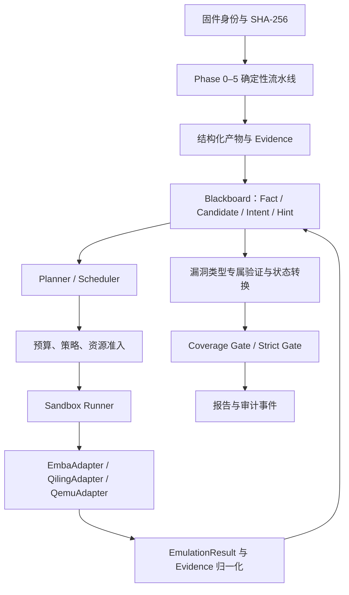

# 路线图（Roadmap）

> 状态基线：2026-11-05（M1–M4 已落地；M6 证据强绑定、M7 动态调度闭环已落地；Qiling 适配器、契约、黑板导入、1.4.6 静态受控目标与 1.4.11 动态 busybox 真实执行已落地）。当前仓库已交付 Phase 0–5 确定性流水线、覆盖率/Strict 门禁、
> 结构化契约、fail-closed 沙箱入口与合成基准；本文件描述在此之上的 **V2 渐进式架构**。
>
> 这是实施计划，不代表下列能力已经全部实现或通过测试。每个里程碑落地前都必须
> 以源码、测试和实际运行结果为准；未完成项不得写进 README / SKILL 的能力声明。

## 0. 一页概览

| 层次 | 当前状态（2026-11） | 目标状态 |
|---|---|---|
| 确定性流水线 | Phase 0–5 已落地；门禁可阻断 | 保持不变，作为控制平面与最终裁决者 |
| 黑板 / 动态探索 | M1 已落地：事实/候选/意图/提示持久化，事件日志 + 快照 + 去重 + 状态机；M7 已落地单 Agent 确定性调度（规则、去重、依赖、准入、重试、回写、阶段前进/回退）；多 Agent 并发编排未实现 | Fact / Candidate / Intent / Hint 持久化，可回放、可去重、可预算 |
| 数据契约 | 24 种 schema，含 Fact / Intent / Hint / EmulationPlan / EmulationResult / BoardState / BoardEvent、QilingPlan / QilingEvent / QilingImport、SchedulerRules / SchedulerResult、ToolIndex、`evidence/1.1` 与 `emba-import/1.0`；状态转换由 `board_transitions.py` 校验，M6 起强制候选自带 run/固件、证据同 run/同固件/同目标并检查生命周期 | 随适配器扩展 `EmulationResult` 后端字段，保持向后兼容 |
| 沙箱 | `sandbox_run.py` 已 fail-closed，但尚未证明所有执行路径都经过它 | 所有解包、执行、仿真、外部工具调用统一入口；隔离失败不回落宿主机 |
| EMBA / Qiling / QEMU | M3 的 EMBA 适配仅用于导入既有日志；M4 的 `emu_plan.py` / `emu_run.py` 已落地并经沙箱执行 QEMU；Qiling 适配器已落地，静态受控目标已在 Qiling 1.4.6 下执行、动态 `busybox` 已在 Qiling 1.4.11 下执行并产出 Evidence | 适配器只消费既有产物；整机仿真按架构/内核/init/网络判据执行，输出统一 `EmulationResult` |
| 检测质量评估 | 合成基准 + 回归门禁 | 增加合法来源、可追溯、人工复核的真实固件基准 |
| EALB | 校准工具已就绪，样本不足时标 `heuristic` | 用真实工时样本校准，并在报告中限定适用范围 |

**近期优先级**：M1（契约与黑板）、M2（资源与沙箱统一）、M3（EMBA 适配器）、M4（整机/定向仿真）已落地；2026-11-05 复查把 **M6 证据强绑定**与 **M7 动态调度闭环**提到 M5 之前并已落地：前者堵住「证据与候选不同 run/固件/目标也能升级」，后者把 Fact→Intent→执行→回写→阶段回退连成可审计闭环。下一步进入 M5（真实固件基准）；网络/服务、多 applet 与厂商内核仍未验证。M0 的盘点动作持续进行，不单独占一个版本。

## 1. 设计原则

1. **确定性控制层不交给模型。** 证据完整性、覆盖率、Strict Gate、沙箱、预算和最终报告
   由代码执行；模型和工具只能提出线索，不能自行认定漏洞成立，也不能绕过硬门禁。
2. **事实与结论分离。** 「观察到 `connect()`」是 Fact；「因此存在 RCE」是 Candidate。
   普通运行事件、扫描告警、工具退出码 0 都不等于漏洞。
3. **失败要可区分。** `FAILED`、`BLOCKED`、`NOT_APPLICABLE`、`TIMED_OUT` 与
   「负面验证」是不同语义；不得把「仿真失败」解释成「漏洞不存在」。
4. **先单 Agent，后并发。** 初期采用单 Agent + 持久化黑板，先把事件日志、回放、去重
   和预算做对，再考虑多 Agent。
5. **复用现有目录。** 不为了架构图搬迁代码；在 `scripts/`、`references/`、`assets/`
   内渐进扩展，保持现有 CLI 与门禁语义。

## 2. 目标架构



控制平面（Phase 0–5、门禁、沙箱、报告）继续负责「什么算完成」；黑板层负责
「下一步查什么」。两者通过版本化契约交换数据，不允许黑板直接改写门禁结论。

## 3. 黑板对象模型

黑板是审计过程的唯一可恢复状态源：`audit-board.json` 保存快照，
`audit-events.jsonl` 保存追加式事件日志。所有对象都绑定 `run_id`、固件 SHA-256、
来源与工具版本。

### Fact

有来源支持、带适用范围的客观观察，例如发现 ELF、解析出架构、EMBA 报告识别出服务、
某次仿真观察到 `connect()`。至少记录：

- `fact_id`、类型与值；
- 固件 SHA-256；
- Evidence 引用；
- 来源定位（文件、偏移、报告行、运行 ID）；
- 工具 / 规则版本；
- 时间与适用范围。

历史冲突保留，用 `supersedes` / `contradicts` 表达。Fact 不是全局永真结论，
换固件、换配置、换工具版本后必须重新确认。

### Candidate

未验证的漏洞线索：漏洞类型、目标组件、支持与反对证据、验证计划、状态、失败原因。
扫描告警或模型判断只能创建/更新 Candidate，不能直接升级为 `VERIFIED`。

### Intent

可执行任务：任务类型、目标、触发它的 Fact / Candidate / Evidence、前置条件、参数、
权限、预算、超时、重试上限、去重键、停止条件、预期产物。Intent 是调度单位，
不是结论。

### Hint

只影响优先级或触发受控审查；不是证据，不能单独改变漏洞状态或交付状态。

### 生命周期与回退

- Candidate 状态转换由显式函数执行：`validate_transition(candidate, target_state,
  evidence_set, policy)`。
- 跨阶段回退写 `BACKTRACK` 事件，记录触发证据、源/目标阶段、原因、预算与批准策略；
  不得悄悄覆盖旧结果。
- 阶段内循环必须有预算、去重、最大尝试次数和停止条件。

## 4. 统一契约：EmulationResult

不同后端可保留专属字段，但公共部分必须一致：

- `schema_version`、`run_id`、`intent_id`；
- `firmware_sha256`、`target_sha256`（适用时）；
- `backend` 与工具版本；
- `status`：`SUCCESS` / `PARTIAL` / `FAILED` / `BLOCKED` /
  `NOT_APPLICABLE` / `TIMED_OUT`；
- `environment`：架构、RootFS、配置、网络、依赖；
- `observations` 与 `evidence_refs`；
- `artifacts`：原始报告、日志、输出文件及 hash；
- `resource_usage`；
- `failure`：类别、原因、阶段、是否可重试；
- `limitations`：未覆盖内容、环境差异、解释边界。

`SUCCESS` 只表示任务按契约完成，不代表漏洞已验证；`PARTIAL` 不得静默折叠为成功。
所有产物绑定运行 ID、固件 hash、工具版本与参数，保留原始日志引用以支持复核和重放。

### Evidence 归一化

原始 syscall / Hook 日志按三层处理：

1. **事件过滤**：按任务目标、事件类别、调用来源与上下文过滤（网络关注
   `connect` / `sendto`，文件关注 `open` / `read` / `write`，进程关注
   `execve`）。规则版本化，保留原始日志引用或必要采样。
2. **命中后捕获上下文**：有限前后调用窗口、进程/线程、模块与地址、调用栈（可用时）、
   规范化参数、输入样本 ID、Hook 类型/位置、规则 ID、stdout/stderr 与原始产物引用；
   敏感值按数据分类脱敏。
3. **Evidence 归一化**：`evidence_id`、`run_id`、固件与目标二进制 hash、工具/版本、
   Hook 机制与位置、过滤规则 ID/版本、时间、事件类型、规范化参数、原始日志/产物引用
   及 hash、环境、资源消耗、解析状态与限制。

注意：`system()` 是 libc 等运行库函数，不是 Linux syscall；应标为库函数/API Hook，
`execve` 等才是 syscall Hook，二者不能混为同一种事件。

## 5. 门禁分层

G1–G7 必须是代码校验器，而不是 Prompt、README 或报告模板。每个 Gate 定义输入对象、
必需字段、验证逻辑、失败码、豁免策略和测试用例。

| 层 | 回答的问题 | 失败时 |
|---|---|---|
| Evidence Integrity Gate | 来源、身份、hash、运行关联、格式是否完整 | 证据不可用，不得进入结论 |
| Coverage Gate | 要求的阶段、目标、分析类别是否覆盖 | 披露缺口或阻断 |
| Strict Gate | 是否满足交付硬性条件 | 不交付 |
| Risk Disposition | 未解决问题如何披露、缓解或接受风险 | `PASS_WITH_DISCLOSURES` / `FAIL` |

要点：

- 不要对所有 Fact 强制要求漏洞触发字段。「发现一个 ELF」只需对象身份、来源证据、
  解析规则和适用范围；漏洞验证按漏洞类型定义标准。
- `Candidate → VERIFIED` 必须通过漏洞类型专属规则，并由显式状态转换函数执行；
  禁止任意代码直接写入 `VERIFIED`。校验失败返回结构化原因，例如
  `MISSING_TRIGGER_CONTEXT`、`EVIDENCE_NOT_BOUND_TO_RUN`、
  `TARGET_HASH_MISMATCH`、`EXPECTED_ACTUAL_NOT_SUPPORTED`、
  `VALIDATION_CRITERIA_NOT_MET`。
- Evidence 完整性通过只代表证据可用且可追溯，不代表漏洞自动成立。
- `ACCEPTED_WITH_RISK` 是风险处置状态，不是漏洞真实性状态；不能把
  `HYPOTHESIS` / `UNVERIFIED` 变成 `VERIFIED`。
- 交付状态可用 `PASS`、`PASS_WITH_DISCLOSURES`、`FAIL`，但必须定义
  可披露缺口与不可豁免要求。

## 6. 沙箱与资源准入

- 所有解包、二进制执行、仿真和外部工具调用统一经过 Sandbox Runner。
- Docker / Podman 或等效隔离启动失败时 **失败关闭**，不能退回宿主机执行。
- 限制网络、挂载、权限、CPU、内存、磁盘、进程数、运行时间和产物大小。
- 不向任务暴露宿主机凭据、SSH Agent、Docker Socket 或不必要的敏感目录。
- 记录镜像、配置、权限、挂载和网络策略版本；审计所有执行分支，防止工具分支绕过沙箱。
- 执行前由 Resource Manager 做资源准入。QEMU 可先从最多 1 个并发、Qiling 1–2 个
  并发开始校准，按实际硬件与耗时调整；资源不足时排队，而不是先启动再发现不足。

## 7. 适配器边界

### EmbaAdapter

先解析既有 EMBA 产物，再按需增加受控调用。校验 `run_id`、固件 hash、工具版本和
环境，结构化解析服务、ELF、架构、依赖、RootFS、启动信息、失败状态，并引用原始报告
和日志。必须区分三类观察，且三者不能互相替代：

1. 报告 / 静态分析识别出服务或二进制；
2. 仿真中实际观察到进程运行；
3. 在特定网络与运行配置下探测到端口响应。

**服务可达不等于 Qiling 可以接管服务。** 转入 Qiling 前必须明确目标二进制路径与 hash、
架构/ABI、解释器与依赖、RootFS 或替代环境、启动参数、配置和输入，并判断目标是否适合
用户态仿真。条件不足返回 `BLOCKED` 或 `NOT_APPLICABLE` 并说明原因。

### Qiling 与 QEMU 分流

- **Qiling**：目标二进制明确、依赖环境可构建、可用受控输入定向验证的用户态执行场景。
- **QEMU 全系统仿真**：依赖固件启动、init 流程、服务初始化、进程间交互或系统配置的场景。

复用 EMBA 代码、规则或其他上游资产前，核对具体版本的许可证、依赖和分发义务。

## 8. 里程碑

### M0：盘点现状（持续）

逐项核查遗留问题，区分「已实现 / 部分实现 / 有代码但未验证 / 未实现」；实际运行测试，
记录命令、版本、退出码与结果。重点确认 Strict、Coverage、沙箱和结构化证据的真实调用路径。

**现状**：2026-10 已完成一轮门禁、契约、沙箱入口与合成基准整改；M3/M4/M7 落地后
selftest 覆盖 27 组 / 340 条断言，`exec_paths.py` 已给出 22 个脚本 / 12 条子进程调用的
分类清单。2026-11-06 增加 Phase 0 前置的 `scripts/tool_index.py`：探测 41 个实现的版本与
可用性，映射 `atomic-capabilities.md` 的 54 项能力，输出 `00-tool-index.json`；缺失工具
给出官方文档、固定安装配方与 fallback，不让 Agent 在 Phase 1/4 才撞 `command not found`。沙箱已在无运行时、Python 桩运行时与 **Ubuntu 24.04.5 + Docker 29.9.2** 下验证
fail-closed、资源准入、超时清理与容器内权限；`sink_scan.py` 的 ast-grep / semgrep
仍属宿主机静态解析。

**验收**：盘点结果以命令、版本、退出码记录并可复算；每条能力声明都能对应到源码或
测试，而不是只引用 README。记录随审计交付物保存，不在仓库里堆能力声明式文档。

### M1：契约与黑板

定义 Fact、Candidate、Intent、Evidence、EmulationResult、BoardState；实现事件日志、
快照、去重和合法状态转换；增加单元测试，并让 Phase 0–5 接入时不改变既有门禁语义。

**交付物**

- `scripts/contracts.py` 增加上述 schema 的校验器，并保持向后兼容；
- 黑板读写与事件日志（`audit-board.json` / `audit-events.jsonl`）；
- `validate_transition` 与结构化失败原因；
- Phase 0–5 的产物可以导入黑板，门禁仍只读原有结构化产物。

**现状（2026-10-27，已落地；2026-11-05 补 M7；2026-11-06 补 ToolIndex）**：`contracts.py` 当时扩到 16 种 schema（含六个黑板对象与 `evidence/1.1`；M3 后为 17 种，M4 后为 21 种，M7 后为 23 种，含 QilingPlan / QilingEvent / QilingImport 与 SchedulerRules / SchedulerResult；增加 Phase 0 工具索引后为 24 种，含 `tool-index/1.0`）；
`board_events.py` 提供 append-only 日志、`seq` 校验与回放；`board_store.py` 提供快照、去重、
导入与状态转换；`board_transitions.py` 提供候选状态机与类型化证据校验。selftest 第 21 组
覆盖重复事件幂等、非法转换拒绝、跨 run 证据拒绝、快照删除后恢复、坏事件行报错和
Phase 0–5 产物导入。M7 已补单 Agent 确定性调度（`board_scheduler.py`）；**未实现**：多 Agent
并发派单、跨进程 claim / heartbeat、Intent 预算执行器。

**验收**：重复事件可去重；非法状态转换被拒绝；快照可恢复；事件日志可回放；
新增单测不改变现有 selftest 的门禁断言。

### M2：资源管理与沙箱

所有执行路径统一经过 Sandbox Runner；实现预算、并发准入、超时、资源限制和失败关闭；
用测试证明隔离失败不会静默转到宿主机执行。

**现状（2026-10-28，已落地）**：`resource_manager.py` 提供 `sandbox-policy/1.0`、跨进程
文件锁槽位与墙钟预算；`sandbox_run.py` 升到 `sandbox-run/1.1`，容器与显式宿主机路径
都先准入，退出码 **5** 表示排队超时或预算耗尽；`exec_paths.py` 用 AST 盘点执行路径并对
未分类调用退出 1；selftest 第 22 组覆盖策略拒绝、排队、预算、超时清理、输出目录权限与清单。

**真实环境复验（2026-10-28）**：Ubuntu 24.04.5 LTS、内核 6.8.0-147、Docker 29.9.0、
`debian:bookworm-slim`。容器内实测 `uid=65534`、仅 `lo`、`CapEff=0`、`NoNewPrivs=1`、
内存上限 512 MiB、固件与根文件系统只读；`/out` 初版因宿主机目录 0755 而 `Permission denied`，
修复为补 other rwx + sticky（0755 → 1757）后可写。隐藏 docker 后 auto 退出 3，且不创建
输出目录；`sleep 30` + `--timeout 2` 退出 124，容器与临时输出目录均被清理；持槽时
`--queue-timeout 1` 退出 5，`--queue-timeout 15` 排队 4.2s 后成功；`--budget 2` 在排队中
耗尽预算退出 5；该环境全量 selftest 为 221 条断言 / 22 组全通过。

**未完成**：Qiling / QEMU / 解包工具尚未全部接入 `sandbox_run.py`；ast-grep / semgrep
仍是 `host-static-analyzer`。

**交付物**

- 执行路径清单与统一入口；
- 预算、并发队列、资源准入；
- 隔离失败、超时、清理的集成测试；
- Linux + Docker 环境下的实测记录。

**验收**：断开 Docker 后任何不可信执行都返回非零且不落盘宿主机；并发超限时排队而非
先启动；超时后容器与临时产物被清理。

### M3：EmbaAdapter

先解析已有 EMBA 产物，再按需增加受控调用；用真实产物 fixture 验证服务、ELF、架构、
依赖和失败状态解析；确保静态发现、运行进程、端口响应各自有明确语义。

**现状（2026-10-30，已落地）**：新增 `scripts/adapter_emba.py`，离线解析 F50 / P99 / S09 /
L15 / L10 / S115，输出 `emba-import/1.0`；F50 必需，缺可选日志为 `partial`，坏行报
`PARSE_ERROR`，缺 F50 / 版本不符 / 固件哈希不符为结构化失败。`--require p99,s09,s115`
把指定产物提升为本次审计必需，缺失即 `failed` + `MISSING_REQUIRED_ARTIFACT`。
三类观察落成不同 `Fact.type`（`service` / `runtime-process` / `port-response`），
证据类型分别为 `static` / `emulation` / `dynamic`，不存在互升路径。P99 的 ELF 落成
`elf`、PE32 落成 `file`；L10 无开放端口时不生成 `port-response`；F50 的
`user_emulation_state` 按计数解释。`contracts.py` 增加 `emba-import/1.0` 校验器
（含 requirements 自洽与 observations 一一对应），`board_store.py import --emba` 在写入前
核对 run / 固件 / status；重复解析输出字节一致，重复导入保持幂等。selftest 第 23 组
覆盖上述路径。仓库内 `assets/emba-sample/` 是按本机 EMBA HEAD `65b7870fb` 的真实
写入点构造的**合成夹具**：F50 的 `write_csv_log()` 会固定追加 NA 填充列，L10 的值带
`IP address:` / `Network mode:` 展示前缀，S09 表头第 4 列 `version_rule` 实际写入的是
app name；适配器分别做了 NA 过滤、前缀剥离与字段正名，并由 selftest 第 23 组钉住。

**未完成**：尚未用真实设备导出的 EMBA 日志复验；受控调用 EMBA（按需启动）未实现。

**EMBA 的定位**：它只是**可选的产物来源**，不是本 skill 的前提。没有现成日志时，
不要为了导入去跑 EMBA；直接走 M4 的轻量整机仿真方法论。

**验收**：同一份 EMBA 产物重复解析结果稳定；缺字段/版本不符时返回结构化失败；
三类观察在黑板中类型不同、不能互相升级；不启动任何仿真即可完成解析。

### M4：轻量整机仿真（EMBA 方法论，不依赖 EMBA）

把 EMBA 的整机仿真流程提炼成不依赖它的判据与命令：架构/内核/init/镜像/网络/观测/失败
分类。优先用 `qemu-system-*` + 最小 ext2 镜像 + user-mode 网络，不安装 EMBA、不跑它的
模块流水线。

**现状（2026-11-03，执行器、真实 rootfs 启动记录、Qiling 适配器、1.4.6 静态目标与 1.4.11 动态 busybox 真实执行已落地）**：`references/emulation-methodology.md`
覆盖 P0–P5、架构与 QEMU 矩阵、镜像构建、启动阶梯、网络模型、证据字段与失败分类。
`emu_plan.py` 已实现只读探测（架构/init/内核/镜像参数/QEMU argv/blockers，不执行）；
`emu_run.py` 已实现计划与哈希复核、固定经 `sandbox_run.py --mode sandbox` 执行 QEMU、
串口分类与 `EmulationResult` 输出；`assets/qemu/Dockerfile` 提供含 QEMU 与 e2fsprogs 的
执行镜像。selftest 第 24 组用假 sandbox 验证计划契约、哈希阻断、串口分类、`kernel-format` 回归与结果字段；第 25 组验证 Qiling 计划、事件过滤、负例与黑板导入。

**Qiling 适配器（2026-11-02，已落地）**：`adapter_qiling.py` 提供 `plan` / `run` / `parse`，只读解析 ELF 架构/解释器/DT_NEEDED，经 `sandbox_run.py --mode sandbox` 执行容器内的 `qiling_runner.py`，按 trigger marker 与 sink hook 重算事件，输出 `qiling-plan/1.0`、`qiling-event/1.0`、`qiling-import/1.0`。普通 `connect()` 只记 `observed`；runner 自报但未命中的 sink-hit 会降级；`host_fallback` 与沙箱不可用一律 `BLOCKED`。`board_store.py import --qiling` 先 evidence、再 fact、最后 `EmulationResult`，并拒绝缺 Intent、跨 run 或跨固件。

**真实 Qiling 执行记录（2026-11-02 / 2026-11-03）**：在 Ubuntu 24.04.5 + Docker 29.9.2 上，Qiling 1.4.6 执行静态 MIPS 受控目标 `qltest-static` 成功；`openat("/etc/QLTEST")` 命中 trigger marker，产生 1 条 sink-hit、`SUCCESS` 结果、3 条 evidence / 3 条 fact，并导入黑板（evidence 4 / facts 4 / intents 1 / emulation_results 1，`verify` 通过）。Qiling 1.4.11 执行同一固件自带的动态 MIPS/musl `busybox cat /etc/QLTEST` 成功，guest 退出码 0，`open("/etc/QLTEST")` 命中 sink，生成 1 条 sink-hit、`SUCCESS` 与 3 条 evidence / 3 条 fact，黑板计数相同。原始产物、哈希、复现命令与边界见 `assets/qiling/real-run-static/README.md` 与 `assets/qiling/real-run-busybox-sink/README.md`。

**版本修正（2026-11-03）**：Qiling 1.4.6 对动态 musl `busybox` 的 `FAILED / memory-error / UC_ERR_WRITE_UNMAPPED` 只说明该版本/该镜像的动态加载问题；1.4.11 复验成功，不能概括为「Qiling 不支持 musl」或「固件动态目标不可执行」。旧动态失败产物已删除；1.4.6 的静态成功记录保留。两项成功都只覆盖受控输入，不构成漏洞结论。

**真实启动记录（2026-10-30）**：Hak5 WiFi Pineapple Nano 的 OpenWrt 19.07.2 rootfs（1,965 个普通文件）在 Ubuntu 24.04.5 + Docker 29.9.2 + QEMU 7.2.22 的 Malta 机器上启动到 BusyBox `/bin/sh`，观察信号为 `shell-prompt`；计划、结果、沙箱报告、串口与文件哈希保存在 `assets/qemu/real-run-malta/`。该次使用 OpenWrt Malta 通用内核，**不是厂商 ath79 内核**；厂商 raw 内核独立尝试得到 `FAILED / kernel-format`（QEMU: not ELF），只能说明格式/machine 不匹配，不能据此判断 rootfs 不可用。

**未完成**：厂商内核/原机语义、网络与服务探测、固件动态二进制的多 applet/服务路径；动态 `busybox` 只验证了 `cat /etc/QLTEST` 一个 applet。`backend_version` 在静态记录中为 `unverified`（QEMU 7.2.22 / Qiling 1.4.6），动态记录中 runner 报告 1.4.11。

**交付物**

- `references/emulation-methodology.md`（已落地）；
- `emu_plan.py`：只读探测 rootfs，输出启动计划（架构、init 候选、内核需求、镜像参数、
  QEMU argv、blockers），不执行（已落地，`emulation-plan/1.0`）；
- `emu_run.py`：经 `sandbox_run.py` 执行 QEMU，采集串口、退出码与清理结果，输出
  `EmulationResult`（已落地，`emulation-result/1.0`）；
- `assets/qemu/Dockerfile`：含 `qemu-system-*` 与 `e2fsprogs` 的执行镜像（已落地）；
- 一个真实 rootfs 的可复现启动记录（命令、内核 sha256、串口日志、退出码）——**已落地**，见 `assets/qemu/real-run-malta/README.md`；
- `adapter_qiling.py` / `qiling_runner.py`：Qiling 定向仿真适配器与容器内 runner（已落地，三份 Qiling schema）；
- Qiling 受控目标可复核 Evidence——**已落地**：静态 MIPS 目标（1.4.6）见 `assets/qiling/real-run-static/`，动态 busybox（1.4.11）见 `assets/qiling/real-run-busybox-sink/`；二者都只覆盖受控输入。

**验收状态：通过（仅限记录范围）。** 已在未安装 EMBA 的 Linux 环境（Ubuntu 24.04.5 +
Docker 29.9.2）让一个真实 rootfs 在 30 秒预算内启动到 `/bin/sh`；厂商内核失败也以结构化
`FAILED / kernel-format` 记录并给出原因；没有把「启动成功」或「端口开放」升级为漏洞结论。
该通过项只覆盖「真实 rootfs 用户态启动」：厂商内核、网络、服务仍未验证；Qiling 分支已完成契约/适配器/真实沙箱执行，并对静态受控目标与动态 `busybox` 产出 Evidence，但未覆盖多 applet/服务路径，不能据此声明完整固件仿真完成。

**定向分支（Qiling）**：整机起不来但目标二进制明确、依赖可控时，走 `adapter_qiling.py`；
已实现事件过滤、上下文捕获、Evidence 归一化，区分 syscall / API / 库函数 Hook；selftest
第 25 组用合成事件证明普通 `connect()`、无标记 `system` 与未命中的自报 sink-hit 都不会
生成漏洞证据。**该分支对已记录目标通过**：静态 MIPS 受控目标在 Qiling 1.4.6、动态 `busybox` 在 Qiling 1.4.11
中经真实 `sandbox_run.py` 运行 `qiling_runner.py`，均在受控输入下产生可复核 Evidence（过滤规则版本化、原始日志可追溯、
`BLOCKED` 与 `FAILED` 可区分）；但只覆盖单目标/单 applet，未覆盖网络、服务、多 applet 与厂商内核，
不能声明完整固件仿真通过。

### M6：证据与状态转换强绑定（先行，2026-11-05 已落地）

**为什么先行**：2026-11-05 复查确认，旧 `validate_transition` 对 contracts 采用可选导入，
导入失败就跳过结构校验；run / 固件只在候选或参数「有值」时才比较；目标哈希只在
policy 与 evidence 同时给出时才检查；无 schema 的历史弱证据仍可用于升级。结果是
「证据来自别的 run / 别的固件 / 根本没有结构」也可能把候选推到 `validated`。这类
缺口会污染后续所有基准与报告，因此先于 M5 修复。

**已落地规则**

- 候选必须**自带**合法 `run_id`（非空、≤128、无空白/控制字符）与 `firmware_sha256`（64 hex）；
  命令行参数只做一致性交叉校验，不再为缺失字段兜底。
- 进入 `validated` / `confirmed` 的证据必须是 `evidence/1.1`；无 schema、其他 schema、
  validator 异常或返回非数组一律 fail-closed。
- 所有参与判定的证据必须同 run、同固件；命令注入/缓冲区溢出/路径穿越/认证绕过/SSRF/
  反序列化还必须带 `target_sha256` 且彼此一致。
- 证据生命周期参与判定：`revoked`、`superseded_by`、`expires_at` 过期、`status=failed`、
  同 `conflict_group` 结论不一致、同 `evidence_id` 不同内容、`supersedes` / `contradicts`
  命中本次选中证据，均拒绝升级。
- `board_events.py` 不再静默过滤找不到的 `evidence_refs`；validator 缺失时返回
  `CONTRACT_UNAVAILABLE`，不返回成功。`board_store.py transition` 在追加事件前先显式
  校验证据引用并跑状态机，失败不落日志。
- `board_transitions.py` 升到 `board-transitions/1.1`，`check` 新增 `--target-sha256`；
  `contracts.py` 的 `evidence/1.1` 增加 `target_sha256` / `content_sha256` / `revoked` /
  `revoked_at` / `expires_at` / `superseded_by` / `conflict_group` / `supersedes` /
  `contradicts` 与 `source.tool_version` / `source.reliability` 可选字段。

**测试**：selftest 第 21 组新增 EV-01..EV-11 负例，分别覆盖候选缺 run、缺固件、证据跨
run、固件不一致、缺目标哈希、缺 schema、contracts 不可导入、多条证据中混入异 run、
证据撤销、证据过期、同冲突组结论不一致、证据声明取代同时选中的证据；另测
`board_store.py transition` 引用不存在证据时返回 `EVIDENCE_REF_NOT_FOUND`。M6 完成时
M6 完成时全量 selftest 为 25 组 / 311 条断言；M7 后为 26 组 / 331 条；加入工具索引第 27 组后为 27 组 / 340 条。

**边界**：历史 `evidence/1.0` 仍可由 `contracts.py` 读取以兼容旧产物，但**不能**用于
`validated` / `confirmed`；黑板导入阶段仍允许先落盘弱证据，升级时统一拒绝。M6 只解决
「证据与状态绑定」，不解决 BoardStore 多进程并发一致性、Evidence 撤销后的黑板级联失效、
真实固件基准或 EALB 校准——这些仍归 M5 与后续工程化项。

### M7：动态调度闭环（2026-11-05 已落地）

**为什么需要**：M1 只把 Fact / Candidate / Intent / Hint 存进黑板，没有把「事实触发任务、
任务领取、执行结果回写、失败重试、阶段前进/回退」连成闭环。缺这一层，黑板只是静态台账；
有了它，探索才能在不绕过门禁与资源准入的前提下持续推进，并且每一步都能从事件日志复核。

**已落地**

- `scripts/board_scheduler.py`：单 Agent 确定性调度器，子命令 `plan` / `next` / `claim` /
  `complete` / `backtrack` / `status` / `rules`；规则从 JSON 读取，不把调度策略写死在代码里。
- `scheduler-rules/1.0`：`when` 支持 `fact_type` / `value_present` / `value_truthy` /
  `value_equals`，未知键直接拒绝；模板只允许 `{value.path}` 这类占位符，不执行表达式。
- 去重键 `dedupe_key = sha256(rule, version, type, target, params)`：同一事实、同一规则、
  同一目标重复评估只返回 `deduped`，不重复创建 Intent，也不增长黑板 revision。
- 优先级：规则 `priority` 0..100；Hint 命中每条 +5、封顶 +15，只改排序，不能绕过门禁或
  把 Candidate 升级。`depends_on` 按规则拓扑排序，环直接拒绝；依赖 Intent 未完成则
  `WAITING`，依赖失败/取消/缺失则 `BLOCKED`，不会永久等待。
- 资源准入：`claim` 先调用 `resource_manager.check_request`；超时/内存/CPU/PID/镜像越界，或策略未允许
  host 时即退出 5，Intent 保持 `open`。`claim` 不占并发槽——真实槽位仍由 `sandbox_run.py`
  在启动命令时获取，避免「领了任务不跑」把槽位耗光。
- 结果回写：`complete` 先用 `scheduler-result/1.0` 校验结果，再写 Evidence / Fact，最后改
  Intent 状态；SUCCESS / PARTIAL / NOT_APPLICABLE → `done`，FAILED / BLOCKED / TIMED_OUT
  且 `retryable=true` 时在 `max_retries` 内回到 `open` 并保留 `last_failure`，超限则 `failed`
  并记录 `outcome`；重复回写同一结果幂等。
- 阶段：`board_store.py advance` 写 `PHASE_ADVANCED`，只能逐阶段前进且必须带原因/可选证据；
  `backtrack` 只能从黑板当前阶段回退，必须带触发证据。两类事件都进追加日志，可 replay / verify。
- 契约：`contracts.py` 新增 `scheduler-rules/1.0`、`scheduler-result/1.0`，`intent/1.1` 扩
  `priority` / `depends_on` / `attempts` / `outcome` / `result_refs` / `last_failure`；
  `PHASE_ADVANCED` 进入 `board-event` 事件类型。

**测试**：selftest 第 26 组覆盖规则合法/未知键拒绝、结果无输出拒绝、Fact→Intent 可追溯、
重复 plan 去重且 revision 不变、next 只列 READY、紧策略 exit 5 且 Intent 保持 open、
claim attempts 递增、可重试失败回 open、超过 max_retries 转 failed + outcome、新 Fact 生成
新 Intent、SUCCESS 回写 Evidence/Fact、PHASE_ADVANCED、BACKTRACK 与最终 verify。全量为
M7 落地时 26 组 / 331 条断言；加入工具索引第 27 组后全量 27 组 / 340 条。

**边界**：当前是单 Agent 串行闭环，没有并发 Planner、跨进程 claim / heartbeat 或抢占；
`stop_conditions` 作为 Intent 的执行契约记录，由执行器遵守，调度器只强制 `max_retries` 与
状态机；`claim` 的资源检查是预检，不代替 `sandbox_run.py` 的真实槽位与预算；这层不判断漏洞，
只保证「谁在什么证据下做了什么、失败如何分类、下一步为什么这样走」可审计。

### M5：真实固件基准

建立合法来源、可追溯且有人工作为真值复核的真实固件基准。评估 Precision、Recall、
误报/漏报、覆盖率、成本和可复现性。合成样本适合回归测试，但不能代替真实基准；
EALB 等启发式估算应使用真实样本校准并报告适用范围。

**现状**：`assets/bench/` 为合成基准（`real_firmware: pending`），只验证流水线契约
与指标计算，不能据此推断真实固件的检测能力。

**验收**：基准清单含来源与许可；标签有复核人/时间；固定命令可复现指标；报告同时给出
Precision / Recall / F1 / FPR、成本与失败样本；真实基准与合成基准分开报告。

## 9. 代码落位（复用现有目录）

不新建 `src/` 大搬迁；按现有约定渐进扩展：

```text
scripts/
  tool_index.py         # 已新增：Phase 0 前置工具探测（tool-index/1.0）
  contracts.py          # 现有：增加 Fact / Intent / EmulationResult / BoardState 校验
  board_store.py        # 新增：快照、查询、去重
  board_events.py       # 新增：append-only 事件日志与回放
  board_transitions.py  # 新增：validate_transition 与状态机
  adapter_emba.py       # 已新增：EMBA 产物离线解析（emba-import/1.0，可选）
  emu_plan.py           # 已新增：只读探测 + 启动计划（不执行）
  emu_run.py            # 已新增：经 sandbox_run 执行 QEMU 并归一化
  adapter_qiling.py     # 已新增：Qiling 计划/执行/事件归一化（qiling-plan/event/import 1.0）
  qiling_runner.py      # 已新增：容器内 Qiling Hook runner（无宿主模式）
  sandbox_run.py        # 现有：作为统一执行入口
  coverage_gate.py      # 现有：消费黑板导出的结构化产物
references/
  data-contracts.md     # 现有：同步新增 schema
  emulation-methodology.md # 已新增：不依赖 EMBA 的整机仿真方法论
  ...
tests/                  # 新增时再引入；当前先用 selftest.py 承载集成回归
```

目录调整必须服务于可测试性，不做纯审美搬迁。

## 10. 质量指标

每次审计输出：输入 hash、阶段状态、覆盖缺口、Candidate 状态分布、Evidence 来源完整率、
仿真成功/部分成功/超时/不可执行比例、资源消耗、真实基准 Precision/Recall、未解决假设、
人工决策与风险披露。不要只用扫描条数或模型候选数代表质量。

## 11. 主要风险与对策

| 风险 | 对策 |
|---|---|
| Fact 缺少来源/范围 | 绑定 Evidence、固件 hash 和运行上下文 |
| EMBA 静态结果被当作运行时事实 | 类型化 Fact，明确来源类别 |
| 把 EMBA 当仿真前提，安装/跑批耗时数小时 | 只导入既有日志；主路径按 `emulation-methodology.md` 用 QEMU 轻量启动 |
| Qiling 日志噪声大 | 过滤、上下文捕获、归一化三层处理 |
| Gate 只在 Prompt 中 | 代码校验器和状态转换测试 |
| 沙箱仅覆盖主路径 | 统一入口并测试失败关闭 |
| 只有合成样本 | 增加真实固件和人工复核 |
| 仿真失败被视为漏洞不存在 | 区分 `BLOCKED`、`FAILED`、`NOT_APPLICABLE` 和负面验证 |
| 过早多 Agent 并发 | 先做单 Agent、事件日志与回放 |

## 12. 实施前检查清单

- [ ] 所有执行路径均经过 Sandbox Runner。
- [ ] 每个任务绑定 `run_id`、固件 hash、工具版本和环境。
- [ ] EMBA 静态发现、实际进程和端口响应分开记录。
- [ ] 服务可达不会自动意味着 Qiling 可接管。
- [ ] syscall Hook 与库函数/API Hook 类型不同。
- [ ] Evidence 保留原始产物引用及 hash。
- [ ] Fact 字段按对象类型校验。
- [ ] Candidate → VERIFIED 由漏洞类型专属规则控制。
- [ ] Evidence Integrity、Coverage、Strict、Risk Disposition 分层。
- [ ] 失败、超时、不适用和负面验证结果可区分。
- [ ] 有真实固件基准和人工复核记录。
- [ ] 测试实际运行并记录结果，而非只引用 README 声称的数量。

## 13. 非目标

- 不在 M1–M2 之前引入多 Agent 并发或自动漏洞利用。
- 不把 EMBA / Qiling / QEMU 的输出直接当结论。
- 不为追求目录布局而大规模搬迁现有脚本、CLI 与门禁语义。
- 不用合成基准的数字对外宣称真实固件检测能力。

## 14. 完成定义

当以下条件同时成立，V2 架构才算落地：

- 任一 Fact 都能追到 Evidence、固件 hash 与运行上下文；
- Fact / Candidate / Intent / EmulationResult / BoardState 均有代码校验器；
- 所有解包、执行、仿真与外部工具调用都经过 Sandbox Runner，隔离失败 fail-closed；
- 整机仿真主路径不依赖 EMBA，能在只有 QEMU + 基础镜像的环境复现；
- `Candidate → VERIFIED` 只能由漏洞类型专属 `validate_transition` 改变；
- Evidence Integrity / Coverage / Strict / Risk Disposition 四层相互独立；
- 真实固件基准可复现地给出 Precision / Recall / 成本，合成基准只作回归；
- 失败、超时、`BLOCKED`、`NOT_APPLICABLE` 与负面验证在报告里可区分。
