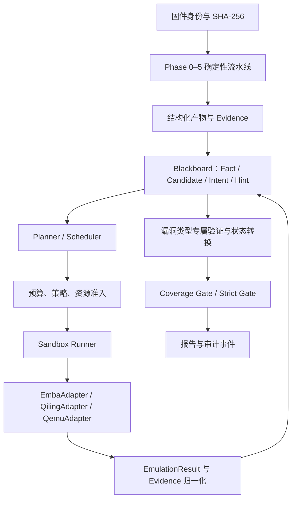

# 路线图（Roadmap）

> 状态基线：2026-10-27（M1 已落地）。当前仓库已交付 Phase 0–5 确定性流水线、覆盖率/Strict 门禁、
> 结构化契约、fail-closed 沙箱入口与合成基准；本文件描述在此之上的 **V2 渐进式架构**。
>
> 这是实施计划，不代表下列能力已经全部实现或通过测试。每个里程碑落地前都必须
> 以源码、测试和实际运行结果为准；未完成项不得写进 README / SKILL 的能力声明。

## 0. 一页概览

| 层次 | 当前状态（2026-10） | 目标状态 |
|---|---|---|
| 确定性流水线 | Phase 0–5 已落地；门禁可阻断 | 保持不变，作为控制平面与最终裁决者 |
| 黑板 / 动态探索 | M1 已落地：事实/候选/意图/提示持久化，事件日志 + 快照 + 去重 + 状态机；Planner / Scheduler 编排未实现 | Fact / Candidate / Intent / Hint 持久化，可回放、可去重、可预算 |
| 数据契约 | 16 种 schema，含 Fact / Intent / Hint / EmulationResult / BoardState / BoardEvent 与 `evidence/1.1`；状态转换由 `board_transitions.py` 校验 | 随适配器扩展 `EmulationResult` 后端字段，保持向后兼容 |
| 沙箱 | `sandbox_run.py` 已 fail-closed，但尚未证明所有执行路径都经过它 | 所有解包、执行、仿真、外部工具调用统一入口；隔离失败不回落宿主机 |
| EMBA / Qiling / QEMU | 仅作为人工选路与交叉验证建议，无适配器、无统一结果契约 | 适配器解析既有产物，按条件准入，输出统一 `EmulationResult` |
| 检测质量评估 | 合成基准 + 回归门禁 | 增加合法来源、可追溯、人工复核的真实固件基准 |
| EALB | 校准工具已就绪，样本不足时标 `heuristic` | 用真实工时样本校准，并在报告中限定适用范围 |

**近期优先级**：M1（契约与黑板）→ M2（资源与沙箱统一）→ M3（EMBA 适配器）→
M4（Qiling 定向仿真）→ M5（真实固件基准）。M0 的盘点动作持续进行，不单独占一个版本。

## 1. 设计原则

1. **确定性控制层不交给模型。** 证据完整性、覆盖率、Strict Gate、沙箱、预算和最终报告
   由代码执行；模型和工具只能提出线索，不能自行认定漏洞成立，也不能绕过硬门禁。
2. **事实与结论分离。** 「观察到 `connect()`」是 Fact；「因此存在 RCE」是 Candidate。
   普通运行事件、扫描告警、工具退出码 0 都不等于漏洞。
3. **失败要可区分。** `FAILED`、`BLOCKED`、`NOT_APPLICABLE`、`TIMED_OUT` 与
   「负面验证」是不同语义；不得把「仿真失败」解释成「漏洞不存在」。
4. **先单 Agent，后并发。** 初期采用单 Agent + 持久化黑板，先把事件日志、回放、去重
   和预算做对，再考虑多 Agent。
5. **复用现有目录。** 不为了架构图搬迁代码；在 `scripts/`、`references/`、`assets/`
   内渐进扩展，保持现有 CLI 与门禁语义。

## 2. 目标架构



控制平面（Phase 0–5、门禁、沙箱、报告）继续负责「什么算完成」；黑板层负责
「下一步查什么」。两者通过版本化契约交换数据，不允许黑板直接改写门禁结论。

## 3. 黑板对象模型

黑板是审计过程的唯一可恢复状态源：`audit-board.json` 保存快照，
`audit-events.jsonl` 保存追加式事件日志。所有对象都绑定 `run_id`、固件 SHA-256、
来源与工具版本。

### Fact

有来源支持、带适用范围的客观观察，例如发现 ELF、解析出架构、EMBA 报告识别出服务、
某次仿真观察到 `connect()`。至少记录：

- `fact_id`、类型与值；
- 固件 SHA-256；
- Evidence 引用；
- 来源定位（文件、偏移、报告行、运行 ID）；
- 工具 / 规则版本；
- 时间与适用范围。

历史冲突保留，用 `supersedes` / `contradicts` 表达。Fact 不是全局永真结论，
换固件、换配置、换工具版本后必须重新确认。

### Candidate

未验证的漏洞线索：漏洞类型、目标组件、支持与反对证据、验证计划、状态、失败原因。
扫描告警或模型判断只能创建/更新 Candidate，不能直接升级为 `VERIFIED`。

### Intent

可执行任务：任务类型、目标、触发它的 Fact / Candidate / Evidence、前置条件、参数、
权限、预算、超时、重试上限、去重键、停止条件、预期产物。Intent 是调度单位，
不是结论。

### Hint

只影响优先级或触发受控审查；不是证据，不能单独改变漏洞状态或交付状态。

### 生命周期与回退

- Candidate 状态转换由显式函数执行：`validate_transition(candidate, target_state,
  evidence_set, policy)`。
- 跨阶段回退写 `BACKTRACK` 事件，记录触发证据、源/目标阶段、原因、预算与批准策略；
  不得悄悄覆盖旧结果。
- 阶段内循环必须有预算、去重、最大尝试次数和停止条件。

## 4. 统一契约：EmulationResult

不同后端可保留专属字段，但公共部分必须一致：

- `schema_version`、`run_id`、`intent_id`；
- `firmware_sha256`、`target_sha256`（适用时）；
- `backend` 与工具版本；
- `status`：`SUCCESS` / `PARTIAL` / `FAILED` / `BLOCKED` /
  `NOT_APPLICABLE` / `TIMED_OUT`；
- `environment`：架构、RootFS、配置、网络、依赖；
- `observations` 与 `evidence_refs`；
- `artifacts`：原始报告、日志、输出文件及 hash；
- `resource_usage`；
- `failure`：类别、原因、阶段、是否可重试；
- `limitations`：未覆盖内容、环境差异、解释边界。

`SUCCESS` 只表示任务按契约完成，不代表漏洞已验证；`PARTIAL` 不得静默折叠为成功。
所有产物绑定运行 ID、固件 hash、工具版本与参数，保留原始日志引用以支持复核和重放。

### Evidence 归一化

原始 syscall / Hook 日志按三层处理：

1. **事件过滤**：按任务目标、事件类别、调用来源与上下文过滤（网络关注
   `connect` / `sendto`，文件关注 `open` / `read` / `write`，进程关注
   `execve`）。规则版本化，保留原始日志引用或必要采样。
2. **命中后捕获上下文**：有限前后调用窗口、进程/线程、模块与地址、调用栈（可用时）、
   规范化参数、输入样本 ID、Hook 类型/位置、规则 ID、stdout/stderr 与原始产物引用；
   敏感值按数据分类脱敏。
3. **Evidence 归一化**：`evidence_id`、`run_id`、固件与目标二进制 hash、工具/版本、
   Hook 机制与位置、过滤规则 ID/版本、时间、事件类型、规范化参数、原始日志/产物引用
   及 hash、环境、资源消耗、解析状态与限制。

注意：`system()` 是 libc 等运行库函数，不是 Linux syscall；应标为库函数/API Hook，
`execve` 等才是 syscall Hook，二者不能混为同一种事件。

## 5. 门禁分层

G1–G7 必须是代码校验器，而不是 Prompt、README 或报告模板。每个 Gate 定义输入对象、
必需字段、验证逻辑、失败码、豁免策略和测试用例。

| 层 | 回答的问题 | 失败时 |
|---|---|---|
| Evidence Integrity Gate | 来源、身份、hash、运行关联、格式是否完整 | 证据不可用，不得进入结论 |
| Coverage Gate | 要求的阶段、目标、分析类别是否覆盖 | 披露缺口或阻断 |
| Strict Gate | 是否满足交付硬性条件 | 不交付 |
| Risk Disposition | 未解决问题如何披露、缓解或接受风险 | `PASS_WITH_DISCLOSURES` / `FAIL` |

要点：

- 不要对所有 Fact 强制要求漏洞触发字段。「发现一个 ELF」只需对象身份、来源证据、
  解析规则和适用范围；漏洞验证按漏洞类型定义标准。
- `Candidate → VERIFIED` 必须通过漏洞类型专属规则，并由显式状态转换函数执行；
  禁止任意代码直接写入 `VERIFIED`。校验失败返回结构化原因，例如
  `MISSING_TRIGGER_CONTEXT`、`EVIDENCE_NOT_BOUND_TO_RUN`、
  `TARGET_HASH_MISMATCH`、`EXPECTED_ACTUAL_NOT_SUPPORTED`、
  `VALIDATION_CRITERIA_NOT_MET`。
- Evidence 完整性通过只代表证据可用且可追溯，不代表漏洞自动成立。
- `ACCEPTED_WITH_RISK` 是风险处置状态，不是漏洞真实性状态；不能把
  `HYPOTHESIS` / `UNVERIFIED` 变成 `VERIFIED`。
- 交付状态可用 `PASS`、`PASS_WITH_DISCLOSURES`、`FAIL`，但必须定义
  可披露缺口与不可豁免要求。

## 6. 沙箱与资源准入

- 所有解包、二进制执行、仿真和外部工具调用统一经过 Sandbox Runner。
- Docker / Podman 或等效隔离启动失败时 **失败关闭**，不能退回宿主机执行。
- 限制网络、挂载、权限、CPU、内存、磁盘、进程数、运行时间和产物大小。
- 不向任务暴露宿主机凭据、SSH Agent、Docker Socket 或不必要的敏感目录。
- 记录镜像、配置、权限、挂载和网络策略版本；审计所有执行分支，防止工具分支绕过沙箱。
- 执行前由 Resource Manager 做资源准入。QEMU 可先从最多 1 个并发、Qiling 1–2 个
  并发开始校准，按实际硬件与耗时调整；资源不足时排队，而不是先启动再发现不足。

## 7. 适配器边界

### EmbaAdapter

先解析既有 EMBA 产物，再按需增加受控调用。校验 `run_id`、固件 hash、工具版本和
环境，结构化解析服务、ELF、架构、依赖、RootFS、启动信息、失败状态，并引用原始报告
和日志。必须区分三类观察，且三者不能互相替代：

1. 报告 / 静态分析识别出服务或二进制；
2. 仿真中实际观察到进程运行；
3. 在特定网络与运行配置下探测到端口响应。

**服务可达不等于 Qiling 可以接管服务。** 转入 Qiling 前必须明确目标二进制路径与 hash、
架构/ABI、解释器与依赖、RootFS 或替代环境、启动参数、配置和输入，并判断目标是否适合
用户态仿真。条件不足返回 `BLOCKED` 或 `NOT_APPLICABLE` 并说明原因。

### Qiling 与 QEMU 分流

- **Qiling**：目标二进制明确、依赖环境可构建、可用受控输入定向验证的用户态执行场景。
- **QEMU 全系统仿真**：依赖固件启动、init 流程、服务初始化、进程间交互或系统配置的场景。

复用 EMBA 代码、规则或其他上游资产前，核对具体版本的许可证、依赖和分发义务。

## 8. 里程碑

### M0：盘点现状（持续）

逐项核查遗留问题，区分「已实现 / 部分实现 / 有代码但未验证 / 未实现」；实际运行测试，
记录命令、版本、退出码与结果。重点确认 Strict、Coverage、沙箱和结构化证据的真实调用路径。

**现状**：2026-10 已完成一轮门禁、契约、沙箱入口与合成基准整改；M1 落地后
selftest 覆盖 21 组 / 202 条断言。但仍缺「所有执行路径逐条列出」的清单，沙箱只在
无容器运行时与桩运行时下验证过 fail-closed，尚未在 Linux + 真实容器上复验。

**验收**：盘点结果以命令、版本、退出码记录并可复算；每条能力声明都能对应到源码或
测试，而不是只引用 README。记录随审计交付物保存，不在仓库里堆能力声明式文档。

### M1：契约与黑板

定义 Fact、Candidate、Intent、Evidence、EmulationResult、BoardState；实现事件日志、
快照、去重和合法状态转换；增加单元测试，并让 Phase 0–5 接入时不改变既有门禁语义。

**交付物**

- `scripts/contracts.py` 增加上述 schema 的校验器，并保持向后兼容；
- 黑板读写与事件日志（`audit-board.json` / `audit-events.jsonl`）；
- `validate_transition` 与结构化失败原因；
- Phase 0–5 的产物可以导入黑板，门禁仍只读原有结构化产物。

**现状（2026-10-27，已落地）**：`contracts.py` 扩到 16 种 schema（含六个黑板对象与 `evidence/1.1`）；
`board_events.py` 提供 append-only 日志、`seq` 校验与回放；`board_store.py` 提供快照、去重、
导入与状态转换；`board_transitions.py` 提供候选状态机与类型化证据校验。selftest 第 21 组
覆盖重复事件幂等、非法转换拒绝、跨 run 证据拒绝、快照删除后恢复、坏事件行报错和
Phase 0–5 产物导入。**未实现**：Planner / Scheduler 自动派单、并发 claim / heartbeat、
Intent 预算执行器。

**验收**：重复事件可去重；非法状态转换被拒绝；快照可恢复；事件日志可回放；
新增单测不改变现有 selftest 的门禁断言。

### M2：资源管理与沙箱

所有执行路径统一经过 Sandbox Runner；实现预算、并发准入、超时、资源限制和失败关闭；
用测试证明隔离失败不会静默转到宿主机执行。

**现状**：`sandbox_run.py` 已 fail-closed，并限制网络、权限、CPU、内存、PID、
运行时间；但 Qiling / QEMU / 解包工具是否全部走它，尚无逐路径证明。

**交付物**

- 执行路径清单与统一入口；
- 预算、并发队列、资源准入；
- 隔离失败、超时、清理的集成测试；
- Linux + Docker 环境下的实测记录。

**验收**：断开 Docker 后任何不可信执行都返回非零且不落盘宿主机；并发超限时排队而非
先启动；超时后容器与临时产物被清理。

### M3：EmbaAdapter

先解析已有 EMBA 产物，再按需增加受控调用；用真实产物 fixture 验证服务、ELF、架构、
依赖和失败状态解析；确保静态发现、运行进程、端口响应各自有明确语义。

**验收**：同一份 EMBA 产物重复解析结果稳定；缺字段/版本不符时返回结构化失败；
三类观察在黑板中类型不同、不能互相升级；不启动任何仿真即可完成解析。

### M4：Qiling 定向仿真

从目标明确、依赖可控的二进制开始；实现事件过滤、上下文捕获、Evidence 归一化；
区分 syscall / API / 库函数 Hook；用负例证明普通运行事件不会被误报为漏洞。

**验收**：至少一个真实二进制在受控输入下产生可复核 Evidence；过滤规则版本化；
原始日志可追溯；普通 `connect()` 事件不会被标成 RCE；`BLOCKED` 与 `FAILED`
可区分。

### M5：真实固件基准

建立合法来源、可追溯且有人工作为真值复核的真实固件基准。评估 Precision、Recall、
误报/漏报、覆盖率、成本和可复现性。合成样本适合回归测试，但不能代替真实基准；
EALB 等启发式估算应使用真实样本校准并报告适用范围。

**现状**：`assets/bench/` 为合成基准（`real_firmware: pending`），只验证流水线契约
与指标计算，不能据此推断真实固件的检测能力。

**验收**：基准清单含来源与许可；标签有复核人/时间；固定命令可复现指标；报告同时给出
Precision / Recall / F1 / FPR、成本与失败样本；真实基准与合成基准分开报告。

## 9. 代码落位（复用现有目录）

不新建 `src/` 大搬迁；按现有约定渐进扩展：

```text
scripts/
  contracts.py          # 现有：增加 Fact / Intent / EmulationResult / BoardState 校验
  board_store.py        # 新增：快照、查询、去重
  board_events.py       # 新增：append-only 事件日志与回放
  board_transitions.py  # 新增：validate_transition 与状态机
  adapter_emba.py       # 新增：EMBA 产物解析
  adapter_qiling.py     # 新增：Qiling 执行与事件归一化
  sandbox_run.py        # 现有：作为统一执行入口
  coverage_gate.py      # 现有：消费黑板导出的结构化产物
references/
  data-contracts.md     # 现有：同步新增 schema
  ...
tests/                  # 新增时再引入；当前先用 selftest.py 承载集成回归
```

目录调整必须服务于可测试性，不做纯审美搬迁。

## 10. 质量指标

每次审计输出：输入 hash、阶段状态、覆盖缺口、Candidate 状态分布、Evidence 来源完整率、
仿真成功/部分成功/超时/不可执行比例、资源消耗、真实基准 Precision/Recall、未解决假设、
人工决策与风险披露。不要只用扫描条数或模型候选数代表质量。

## 11. 主要风险与对策

| 风险 | 对策 |
|---|---|
| Fact 缺少来源/范围 | 绑定 Evidence、固件 hash 和运行上下文 |
| EMBA 静态结果被当作运行时事实 | 类型化 Fact，明确来源类别 |
| Qiling 日志噪声大 | 过滤、上下文捕获、归一化三层处理 |
| Gate 只在 Prompt 中 | 代码校验器和状态转换测试 |
| 沙箱仅覆盖主路径 | 统一入口并测试失败关闭 |
| 只有合成样本 | 增加真实固件和人工复核 |
| 仿真失败被视为漏洞不存在 | 区分 `BLOCKED`、`FAILED`、`NOT_APPLICABLE` 和负面验证 |
| 过早多 Agent 并发 | 先做单 Agent、事件日志与回放 |

## 12. 实施前检查清单

- [ ] 所有执行路径均经过 Sandbox Runner。
- [ ] 每个任务绑定 `run_id`、固件 hash、工具版本和环境。
- [ ] EMBA 静态发现、实际进程和端口响应分开记录。
- [ ] 服务可达不会自动意味着 Qiling 可接管。
- [ ] syscall Hook 与库函数/API Hook 类型不同。
- [ ] Evidence 保留原始产物引用及 hash。
- [ ] Fact 字段按对象类型校验。
- [ ] Candidate → VERIFIED 由漏洞类型专属规则控制。
- [ ] Evidence Integrity、Coverage、Strict、Risk Disposition 分层。
- [ ] 失败、超时、不适用和负面验证结果可区分。
- [ ] 有真实固件基准和人工复核记录。
- [ ] 测试实际运行并记录结果，而非只引用 README 声称的数量。

## 13. 非目标

- 不在 M1–M2 之前引入多 Agent 并发或自动漏洞利用。
- 不把 EMBA / Qiling / QEMU 的输出直接当结论。
- 不为追求目录布局而大规模搬迁现有脚本、CLI 与门禁语义。
- 不用合成基准的数字对外宣称真实固件检测能力。

## 14. 完成定义

当以下条件同时成立，V2 架构才算落地：

- 任一 Fact 都能追到 Evidence、固件 hash 与运行上下文；
- Fact / Candidate / Intent / EmulationResult / BoardState 均有代码校验器；
- 所有解包、执行、仿真与外部工具调用都经过 Sandbox Runner，隔离失败 fail-closed；
- `Candidate → VERIFIED` 只能由漏洞类型专属 `validate_transition` 改变；
- Evidence Integrity / Coverage / Strict / Risk Disposition 四层相互独立；
- 真实固件基准可复现地给出 Precision / Recall / 成本，合成基准只作回归；
- 失败、超时、`BLOCKED`、`NOT_APPLICABLE` 与负面验证在报告里可区分。
